# 亚马逊DSP（DVA）创编拆解及Agent解决方案_1015

| 版本号 | 更新时间 | 更新人 | 更新内容 | 备注 |
| --- | --- | --- | --- | --- |
| 版本号 | 更新时间 | 更新人 | 更新内容 | 备注 |
| V_1.0.1 | 2026.10.19 |  | - 更新了完整的流程图。 - 更新了多维表单对应图。 - 新增期望路径功能。 |  |
| V_1 | 2026.10.15 |  | 初版文档 |  |

## 项目目标
实现 AMZ DSP 广告从 MP 表格到广告后台的映射和创建。
入口链接：https://advertising.amazon.com/dsp/<ACCOUNT_PATH>
### 期望能力路径
1. agent创建DSP广告。
2. 人工需要把自己的组内的 MP 表格（可按照后文标准来，需要 2 条路径），按要求填入多维表格，完成创建。需要一个 Skill 将 MP 表格倒入多维表格。
3. Audience稳定创建、Creatives稳定创建。
4. 表现数据数据拉取。
5. 表格到 DSP 后台的创建和映射规则。
6. 表格回填。
7. 账户管理和AI营销平台授权管理（内部自动化平台的运行基础）
8. 允许第三方sdk或其他协议接入使用。
## 目前业务的情况
### 现有状况
1. 目前已有多维表格可以稳定的实现创建流程。
2. Audience受限于规模不可控且审核时间长，用户仍然倾向于后台创建。
3. 无标准化MP表格，可根据我们要求标准化。（备注：目前DSP自动化能力相对完整、错误率低，所以目前 meta 创编的错误率是不可忍受的）
1. 之前其他平台的经验： meta 平台的方式是沉淀规则，建立 mapping 实现；但表格动态调整和复杂度上升后（如多子表关联、透视表等），执行准确度下降、速度下降。
4. 表格回填。
### 账户体系
```plain
Amazon DSP 账户体系
│
└── 1. Entity（实体账户） （公司主体）
├── 对应一个广告主或代理商
├── 唯一的 Entity ID，所有预算、报告、受众数据汇总在此层
└── 2. Advertiser（广告主）（一个adv只能关联一个店铺）（一个Entity可关联多个adv）
├── 隶属于 Entity，代表具体品牌或业务单元
├── 可设置品牌安全 (Brand Safety) 规则
├── Audience 在此层管理
└── 3. Order（订单）
├── 对应一个广告活动/投放计划
├── 设置：预算、Flight、频次上限、KPI目标
└── 4. Line Item（行项目）
├── 具体的投放执行单元
├── 设置：出价策略、受众定向、版位、频次
└── 5. Creative（素材）
├── 关联到 Line Item
└── 类型：Display / Video / Audio
```
> Entity 一般以客户划分，Advertiser 一般以品牌划分，order 层级提供策略，line items 执行策略。
>
> - 同一个客户有多品牌和多站点，可在同一个 entity 下建不同 advertiser。
> - 不同品牌需要建不同 advertiser：一个 advertiser 只能填一个 merchant token（用于归因去重），对应一个 seller center。
#### 需要明确的问题：
1. Entity：需要独立授权，需要明确，授权Entity可控制下方所有adv吗？
#### **旧版界面**
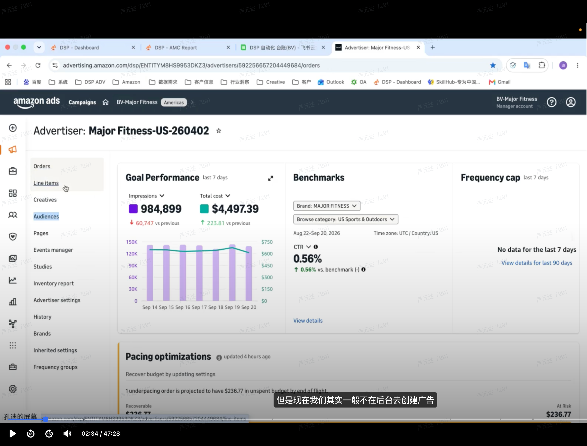
#### **新版界面**
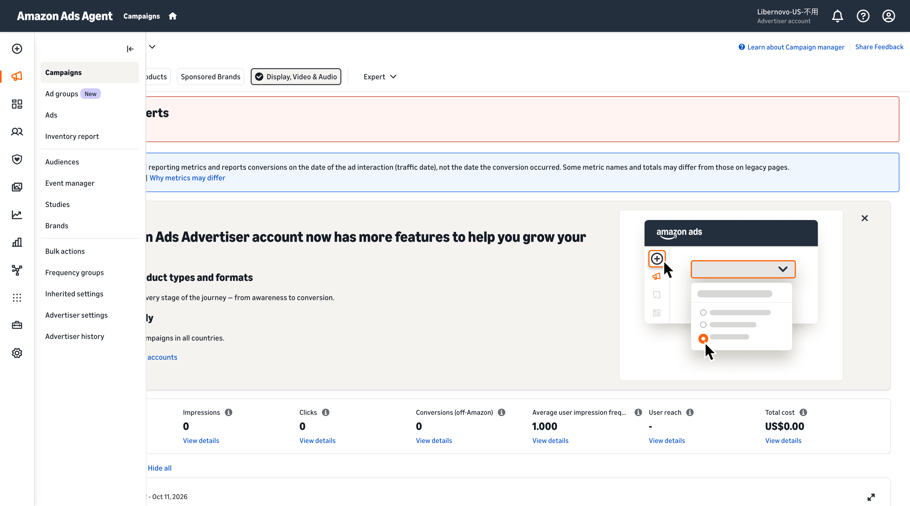
> 底层没有太大变化，需要关注后续是否会有调整。
### 平台命名变动

| **所属阶段 / 场景** | **旧版名称** | **新版名称** | **作用** | **下一层级包含的具体选项 / 可配置内容** | **备注** |
| --- | --- | --- | --- | --- | --- |
| **所属阶段 / 场景** | **旧版名称** | **新版名称** | **作用** | **下一层级包含的具体选项 / 可配置内容** | **备注** |
| 广告结构与搭建阶段 | Orders | Campaigns | “Order（订单）”新版本 **Campaigns（广告活动）**。是最高层级的管理单元，用于设定总预算、整体投放日期、整体目标和KPI。 | - 广告活动列表 / 状态（启用、暂停、归档） - 预算与排期设置（总预算、每日预算、投放起止时间 Flight dates） - 目标与KPI设置（如 CPA、ROAS 目标） - 关联产品/品牌 |  |
| 广告结构与搭建阶段 | Line items | Ad groups | 旧版的“Line item（行项目/投放明细）”对应新版 **Ad groups（广告组）**。用于在同一广告活动下精细化管理受众定位、出价策略、预算分配及创意绑定。 | - 受众定位 (Audiences)（亚马逊购买意向受众、生活方式受众、自定义受众、第一/三方数据受众） - 库存来源/供应源 (Supply / Exchanges)（亚马逊自有及合作站点、第三方 SSP） - 出价与预算分配（竞价策略、动态出价、行项目/广告组预算） - 投放设备与地理位置定向（Desktop、Mobile、Connected TV、特定国家/地区） |  |
| 广告结构与搭建阶段 | Creatives | Ads | 旧版的“Creatives”对应新版 **Ads**。用于管理具体的广告素材（如图片、视频、显示广告等文案和多媒体内容）。 | - 展示广告素材（Custom Image、Display Banner、Responsive E-commerce Display） - 视频广告素材（Out-stream Video、In-stream Video、Over-the-Top / CTV 视频） - 品牌旗舰店/商品落地页链接（ASIN 绑定、Store 链接、外部跳转链接） - 创意合规与审核状态 | 如若创建line item，需要先创建/关联已存在的Order（必须） |
| 广告结构与搭建阶段 | Audiences | Audiences | 用于创建、管理和分析定向受众。 | - Amazon Audiences（亚马逊原生兴趣/购买意向受众） - Advertiser Audiences（自定义受众、像素触达人群、CRM上传人群） - Lookalike Audiences（相似受众） | 需要单独创建。 |
| 页面/展示管理阶段 | Pages | - | 用于管理广告指向的落地页或店铺页面结构。 | - 品牌旗舰店 (Store) 子页面 |  |
| 效果追踪与归因验证阶段 | Event manager | Event manager | 用于管理广告转化像素、数据源及受众触达的事件追踪。 | Amazon Attribution（站外归因链接） Pixels / Conversion Tags（像素与转化代码） Audiences Source（受众数据源接入） |  |
| 品牌提升与实验评估阶段 | Studies | Studies | 用于开展品牌提升研究、跨渠道效果分析等测试。 | Brand Lift Studies（品牌提升研究） |  |
| 流量与资源预判阶段 | Inventory report | Inventory report | 用于查看可用的广告位、流量资源及相关的库存投放表现数据。 | Publisher / Exchange 报告 |  |
| 账户与全局配置管理阶段 | Advertiser settings | Advertiser settings | 管理广告主账户的常规配置与权限。 | 账户基本信息与时区设置 |  |
| 账户与全局配置管理阶段 | History | Advertiser history | 查看账户内各项设置和广告调整的历史操作日志。 | 操作日志 (Audit Trail) |  |
| 品牌资产与全局控频阶段 | Brands | Brands | 用于管理关联的品牌资产。 | 品牌 Store 授权管理 |  |
| 账户与全局配置管理阶段 | Inherited settings | Inherited settings | 管理继承自上一层级的共享设置。 | 全局共享的品牌及默认白名单/黑名单 |  |
| 品牌资产与全局控频阶段 | Frequency groups | Frequency groups | 用于跨广告活动控制用户看到广告的最高频次（频次上限设置）。 | 频次上限规则（例如：每 24 小时内最多向同一用户展示几次广告） 跨广告活动频控绑定 |  |

> 虽有名称变化，但DSP类型广告暂无调整
## 创建流程
### 手动流程
#### 第一步：建立 Order
**Order 创建共 7 个填写板块：**
- 第一栏基础信息
- 第二栏 Media（Type media）
- 第三栏 Goal and Optimization
- 第四栏 Commitments
- 第五栏 Budget and flights
- 第六栏 Conversion tracking
- 第七栏 Targeting and optimization。
> 各栏完整字段见「平台内容字段详解」章节。

| **首页展示** |
| --- |
| **首页展示** |
|  |

1. **填写基础信息**

| **填写基础信息** |
| --- |
| **填写基础信息** |
|  |

#### 第二步：建立 Line items
1. **新建 line 需要关联已创建的 order**
> 需要 API 接口数据回拉

| **新建 line 需要关联已创建的 order** |
| --- |
| **新建 line 需要关联已创建的 order** |
| 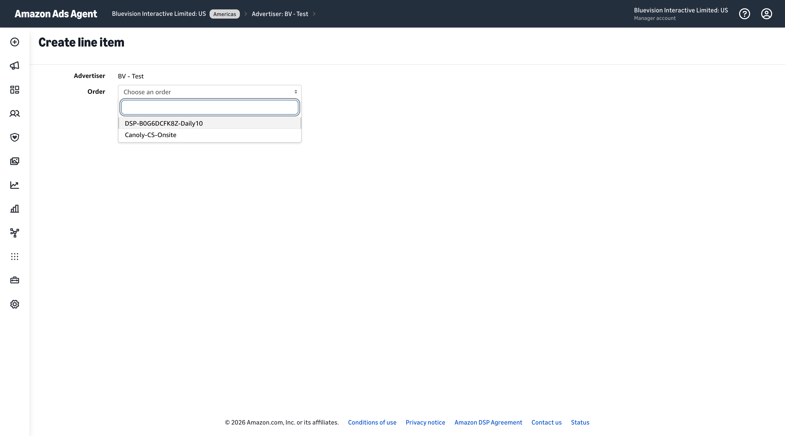 |

1. **配置 Line item**
> 不同的展示页面关联配置略有区别；人群和素材需要单独创建
- 第一步基础设置（Name、External ID or PO、Comments）
- 第二步媒体配置（media type 分，部分设置 type 不同选项不同）：
- Media Type - Display（图片广告）
- Media Type - Online Video（在线视频广告）
- Media Type - Streaming TV（流媒体电视广告；分 All Content 与 Live Events Optimizer 两种 Strategy，影响后续配置，独立拆解对比）
- Media Type - Audio / Digital Out-Of-Home / Audio Guaranteed / Podcast（暂不涉及）
#### 第三步：建立 Audience（独立创建，关联至 Line items）
目前业务倾向于手动创建，原因：人群规模自动化无法展示，经常有规模问题创建失败，且需要最多 48 小时的审核，后台可及时反馈（优先级可退让）。
**Audience 类型（现阶段只涉及高优先级）**

| **Audience 类型** |
| --- |
| **Audience 类型** |
| 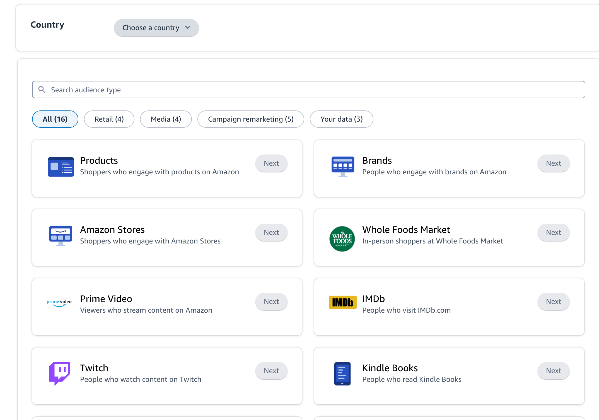 |

- Products - Shoppers who engage with products on Amazon
- Brands - People who engage with brands on Amazon
- Amazon Stores - Shoppers who engage with Amazon Stores
**创建步骤**
1. 第一步：选择国家 + 人群类型（主要定位数据来源）。选择国家（必选），一般绑定账号投放地区，需要考虑单一账号多地区投放的情况，其他类似的情况也要考虑，可选国家数据如何拉回；再选择人群来源类型。
2. 第二步：基于人群数据来源创建人群包（Products / Brands / Amazon Stores 三种来源的配置字段见「平台内容字段详解」章节）。
#### 第四步：建立 Creatives（独立创建，关联至 Line items）
**素材类型（4 大类）**

| **素材类型** |
| --- |
| **素材类型** |
| 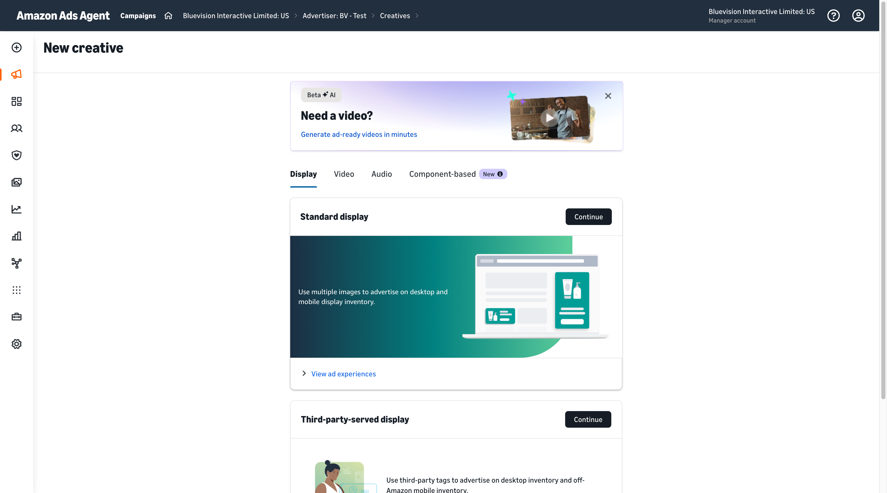 |

- Display - 图片素材
- Video - 视频素材
- Audio - 音频素材（暂不涉及）
- Component-based - 基于组件的素材（对应多维表格响应式电商素材）
### 自动化流程（多维表格）
六大板块：Creatives、Orders、Line、Audience、Order调整、Line调整，各板块字段、填写方式、作用、对应平台字段、对应 API 接口、MP 对应字段与备注如下。
#### MDP、DSP自动化表格及Line items模版的对应关系
#### API接口文档（待补充）
### 业务侧创建过程确认要点
| **主题** | **业务确认内容** |
|-|-|
| DSP 入口 | https://advertising.amazon.com/dsp/<ACCOUNT_PATH> |
| Order - 命名 | Name 由多个字段组合成长串（命名规范）；KPI 之前的字段大多只影响命名。 |
| Order - Country | 写死在后台（读取 advertiser 站点）；手动创建为必填，多维表格中不涉及。 |
| Order - KPI | 策略阶段（如 CV/TTV）与 KPI 自动关联，API 有一一对应关系。 |
| Order - 优化策略 | 默认写死两个选项；KPI target、manager budget 等仅调优时人工使用，非普遍情况。 |
| Order - Option settings | 全部不填。 |
| Order - 预算 | 拆单月管理：3 个月 → 后台创建 3 个独立 flight（每月 1 号至月底）；日预算/月预算二选一，共同影响总预算值。 |
| Order - Budget cap | 控制日/月不花超（daily / monthly + 金额）。 |
| Order - 服务费 | 写死 15%（Agency fee）。 |
| Order - Tracking ASIN | 逗号分隔一串；来源为投放计划或客户提供，一定有，来源不必担心。 |
| Order - 素材关键词 | 不在 campaign setting 内；用于创建后自动关联素材。 |
| Order 调整 | frequency 等为可选项：先建 order，需要时再在 Order 调整中修改。 |
| Line - 强关联 | 必须先有 Order 才能创建 Line item（强关联）；Audience、Creatives 可单独创建。 |
| Line - 预设范式 | Line item 内置多套配置范式（模板），选择即整套 setting（bid、最高/最低出价、type、设备等固定），不是逐项详细填写。 |
| Line - 后台 Tab | line item 下 creatives / report 渠道 / line item setting / history 四个入口，实际只用 setting，其余为报表展示。 |
| Line - Category | 父类:子类层级（如 Home and Garden:bathroom）；亚马逊平台该字段一般不变。 |
| Line - 人群 | 固定 ID 人群用 AND/NOT 公式（对应 include / exclude 框），无 all 选项；实时人群 PA / CA / Keywords 三类，从 MP 表格直接复制。 |
| Line - Location | 写死，与 Order 的 country 强关联（基于商户站点）。 |
| Creative - 类型 | 常用图片（Standard Display）、响应式（Responsive）、视频三类；Audio 无人投放，不用。 |
| Creative - 关联 Order | 通过命名关键词自动关联：creative name 含关键词（如 SSPD），Order 创建时填素材关键词即自动关联；creative type 不匹配会报错（按名称+类别检索）。 |
| Creative - Language | 写死（当地 local）。 |
| Creative - 落地页 | URL（click-through）；brand store / other website 为新出选择功能，自动化未用；一般站内闭环落地到 ASIN。 |
| Creative - 聚合尺寸 | 是=一个 creative 放多个尺寸（1:N）；否=一对一逐尺寸创建（尺寸用英文逗号分隔）。 |
| Creative - KPI | 前端已删除该设置，但 creative setting API 仍保留字段；自动化保留该列（当前无实际优化作用）。 |
| Creative - 捆绑 ASIN | 仅对 Responsive 有作用：是=捆绑多个 ASIN，否=1 个。 |
| Creative - Video | 视频自动化未完成；上传文件格式决定 Online Video / Streaming TV 勾选（时长/尺寸/大小要求）；业务期望先选类型再匹配文件（与平台识别逻辑相反）。 |
| Audience - 使用习惯 | 极少用自动化创建，习惯手动：平台对人群数量设限、人数过少创建失败；创建成功后 1-2 小时才反馈，自动化试错成本高。 |
| Audience - 维度 | 常用 ASIN（Products）/ 品牌（Brands）/ 店铺（Amazon Stores）三类；三类均可创建竞品人群（竞品浏览/购买等）。 |
| Audience - 创建 | 按行为一对一创建独立人群包（购买、浏览、相似浏览、搜索、加购、订阅等）；Description 写备注方便统一管理。 |
| Audience - Lookback | 自定义，不能写死（7 / 3 / 14 / 30 / 60 / 90 天都会设置）。 |
| Audience - 痛点 | 品牌/店铺输入后平台返回大量相似结果，自动化难精准勾选目标；店铺可选择整个店铺或子页面。 |
| Audience - 回填 | 创建成功后生成 audience ID，复制到 Order 的 Audience 字段绑定。 |
| ASIN | 亚马逊平台上产品的唯一编码（产品页面可见）；自有、竞品、市场产品均可获取。 |
| 待确认 | Audience 新建页面新增 country 必填选项（不选无法创建），底层逻辑待确认。 |
## 平台内容字段详解
以下为平台各层级字段的作用、填写方式、备注与官方 API 接口对照。字段级疑问完整保留在各表「备注」列。
> API 信息仅来源于亚马逊官方
### 多维表格板块字段（自动化创建表单）
六大板块：Creatives、Orders、Line、Audience、Order调整、Line调整，各板块字段、填写方式、作用、对应平台字段、对应 API 接口、MP 对应字段与备注如下。
> 搭建 order 的时候会把 line 的表格的数据一起搭进去。
>
> DSP 自动化demo
>
> DSP自动配置line items模版-all

| **Creatives（内置很多既定程序）** | | | | | | | | | |
| --- | --- | --- | --- | --- | --- | --- | --- | --- | --- |
| **Creatives（内置很多既定程序）** | | | | | | | | | |
| **表头** | **填写内容** | **内容示例** | **要求** | **作用** | **对应平台字段** | **对应API接口** | **MP表中是否有对应字段** | **MP对应字段定位** | **备注** |
| **填写人** | 用户名称 | 示例用户 | **填写人名称** **必填** |  |  | 操作日志字段（非平台创建接口） |  |  |  |
| **广告主** | 广告主链接 | https://advertising.amazon.co.uk/dsp/<ACCOUNT_PATH>/advertisers/ADVERTISER_<ID>/orders | **广告主链接** **必填，格式严格按照“****https://advertising.amazon.com/dsp/<ACCOUNT_PATH> |  |  | 账号层级：官方API请求体 advertiserId（Entity/Advertiser 授权） |  |  | 为什么是链接，不是账户id |
| 类型（多选） | Responsive eCommerce Standard display Online Video | Online Video | **必填，选择对应类型的素材** |  |  | 官方素材创建接口 /dsp/v1/adCreatives（Creative management） |  |  | 需要看下类别有没有新增 |
| **是否聚合尺寸** | 判断 是 否 | 是 | **选填，不选默认“否”** **“是”：会建一个11个尺寸的素材** **“否”：会每种尺寸分别建素材** |  |  | 素材尺寸规格（adCreative 创建时指定） |  |  | 两种的效果是什么样的？ |
| **KPI（单选）** | CTR PR DPVR | CTR | **选填，不选默认建3种KPI** **选择则创建 REC（Responsive eCommerce Creative，动态电商素材） 素材指定KPI类型的素材 （只有REC 素材用得到）** |  |  | Campaign 优化 KPI：goalSetting.kpi（官方） |  |  | 是否可多选/除了这些还有哪些？ |
| 尺寸（多选） | 160x600,300x250,300x600,320x50,728x90,970x250,980x55,245x250,650x130,414x125,350x420,336x280,300x50 | 160x600,300x250 | **可定义REC（响应式电商） 素材的创建的尺寸，不填默认创建全部尺寸** |  |  | 素材尺寸规格（adCreative） |  |  |  |
| **品线名** | 产品名称 | TOP ASIN | **IMG 素材：必填，不填会使用“CI”命名** **REC 捆绑类型素材：必填，用于命名** **VIDEO 素材：必填，用于headline 填写** |  |  | 业务命名规则（非平台字段） |  |  | **IMG 素材：必填，不填会使用“CI”命名** **REC 捆绑类型素材：必填，用于命名** **VIDEO 素材：必填，用于headline 填写**  需要明确都是业务规则吗？要确保通用型 |
| **是否捆绑ASIN** | 判断 是 否 | 是 | **必填，判断素材是否多个AISN 一起创建，选“是”会把同一品线名创建为同一素材** |  |  | 业务规则（非平台字段） |  |  | 否是什么？ |
| **自定义命名tag** | 名称 | TOP ASIN Creatives | **选填，用于各种素材的自定义命名** |  |  | 业务命名规则（非平台字段） |  |  |  |
| ASIN | 编码 | ASIN_53,ASIN_15,ASIN_22,ASIN_19,ASIN_43,ASIN_28,ASIN_39,ASIN_13,ASIN_16,ASIN_42,ASIN_20,ASIN_40,ASIN_41,ASIN_54,ASIN_24,ASIN_46,ASIN_08,ASIN_12,ASIN_07,ASIN_18 | **除IMG 素材外必填，IMG 也必须保证“自定义命名tag”和 “ASIN”必填其一** |  |  | 产品关联：POST /dsp/v1/campaigns/{campaignId}/conversionTracking/products（官方） |  |  | ASIN的作用是什么 |
| **asin_url** | 链接 | - | **MG 、video 素材必填** |  |  | 落地页 URL：adCreative click-through destination（官方） |  |  | 还有哪些素材类型？ |
| **logo** |  | - | **REC 素材创建 自定义LOGO 时必填** |  |  | 素材组件上传：POST /assets/upload + PUT（官方） |  |  | **填什么？上传图片？还是什么？** |
| **logo headline** |  | - | **logo 的 headline** **不填默认不配置** |  |  | 素材组件上传：POST /assets/upload + PUT（官方） |  |  | **填什么？** |
| **自定义附件** |  |  | **选填，放各种附件，除视频素材外，使用同名的zip 格式。** **视频素材直接上传视频（建议MP4），不用压缩** |  |  | 素材文件上传：POST /assets/upload + PUT（zip/视频，官方） |  |  | 作用是什么？关联到哪里？ |
| **自动化操作时间** | 时间 | 2026-01-19 11:47:05 | 操作日志 |  |  | 操作日志回填（非平台接口） |  |  |  |
| **自动化操作结果** | 成功 失败 | TRUE | 操作日志 |  |  | 操作日志回填（非平台接口） |  |  |  |
| **自动化操作说明** | 操作记录 | {'CTR': ['ALL'], 'msg': [], 'creative_id': ['CREATIVE_']} | 操作日志 |  |  | 操作日志回填（非平台接口） |  |  |  |
| **自动化提醒** | 失败原因 | - | 操作日志 |  |  | 操作日志回填（非平台接口） |  |  |  |

| **Orders** | | | | | | | | | |
| --- | --- | --- | --- | --- | --- | --- | --- | --- | --- |
| **Orders** | | | | | | | | | |
| **表头** | **填写内容** | **内容示例** | **要求** | **作用** | **对应平台字段** | **对应API接口** | **MP表中是否有对应字段** | **MP对应字段定位** | **备注** |
| **填写人** | 用户名称 | 示例用户 | **填写人名称** **必填** |  |  | 操作日志字段（非平台创建接口） |  |  |  |
| **广告主** | 广告主链接 | https://advertising.amazon.co.uk/dsp/<ACCOUNT_PATH>/advertisers/ADVERTISER_<ID>/orders | **广告主链接** **必填，格式严格按照“****https://advertising.amazon.com/dsp/<ACCOUNT_PATH> |  |  | 账号层级：官方API请求体 advertiserId（Entity/Advertiser 授权） |  |  | 为什么是链接，不是账户id |
| **品牌** | 品牌名称 | UPSIMPLES | **order 名称构成** **除“自定义列”外，其他必填** **"策略阶段"目前支持：AW、CS、RT、LY、CV** |  |  | Order 名称构成（业务命名规则） |  |  |  |
| **品线** | 产品名称 | Multi Packs PIcture Frames |  |  |  | Order 名称构成（业务命名规则） |  |  |
| **策略阶段** | 阶段名称 **AW、CS、RT、LY、CV** | CS |  |  |  | Order 名称构成（业务命名规则：AW、CS、RT、LY、CV） |  | **除了****AW、CS、RT、LY、CV****还有哪些？** |
| **人群** | 人群包名称 | CXT KW 5x7 picture frame |  |  |  | Order 名称构成（业务命名规则） |  | 名称冲哪里来？收否需要跟某些预设进行关联。 |
| **落地页** | URL | DP |  |  |  | 落地页/转化跟踪：conversionTracking/products 或 click-through（官方） |  | DP是什么？不应该是url么？ |
| **KPI** | 指标类型 | ROAS |  |  |  | Campaign 优化 KPI：goalSetting.kpi（官方） |  | 除了ROAS还有哪些？是填写？还是关联？ |
| **target KPI** | 目标KPI | - |  |  |  | goalSetting.targetKpi（官方：POST/PATCH /dsp/v1/campaigns） |  | 有哪些？作用是什么？ |
| **自定义列** | ？ | ？ |  |  |  | 待补充（原文档未定义） |  | 是什么？需要补充 |
| **投放开始时间** | 时间序列 |  | **投放开始时间** **必填，周期不要超过12个月** |  |  | flights[].startDateTime（官方：POST /dsp/v1/campaigns） |  |  |  |
| **投放结束时间** | 时间序列 |  |  |  |  | flights[].endDateTime（官方） |  | 有无最短时间限制？ |
| **预算(****日预算****）** | 金额 | 50 | **预算** **两个必填其一，两个都填会使用“日预算”** |  |  |  |  |  | 用没有货币类型选择？ |
| **预算(****月预算****）** | 金额 | 600 |  |  |  |  |  |  |
| **BudgetCap Type** |  |  | **Budget Cap** **非必填，可选填写** |  |  | Campaign budget cap：daily/monthly spending limit（官方） |  |  | 关联的是哪部分？ |
| **BudgetCap Amount** |  |  |  |  |  | Campaign budget cap（官方） |  | 关联的是哪部分？ |
| **tracking asin** | 追踪编码 | ASIN_04,ASIN_14,ASIN_01,ASIN_30,ASIN_33,ASIN_34,ASIN_32,ASIN_31 | **必填** |  |  | POST /dsp/v1/campaigns/{campaignId}/conversionTracking/products（官方） |  |  |  |
| **素材关键词** | 关键词内容 | Multi Packs PIcture Frames%%CTR | **line素材关键词** **选填，用于搜索添加到line里的素材，不填写会使用"tracking asin" 进行搜索，如果要建空的line，请填写"空line"** |  |  | 业务规则（用于搜索添加到 line 的素材） |  |  |  |
| **creative type（多选）** | 素材类型 Responsive eCommerce,Standard display | Responsive eCommerce,Standard display | **line 配置** **除"Line Name" 以外其他必填。"line Name"不填则根据各个服务中心的要求配置所选的进行创建** |  |  | Ad group inventoryType（DISPLAY/STREAMING_TV/ONLINE_VIDEO，官方） |  |  | 除了这几个还有其他的吗？如果与素材类型不匹配会怎么样？ |
| **Line Name（多选）** | 名称？（需确认） L-ONSITE-PC-LV,L-ONSITE-PC-HV,L-ONSITE-MOB-LV,L-ONSITE-MOB-HV,L-OFFSITE-MOB-IOS,L-OFFSITE-MOB-NON IOS,L-OFFSITE-PC-DESKTOP,L-OFFSITE-MOB-WEB,L-ONSITE-PC,L-ONSITE-MOB,L-OFFSITE-PC,L-OFFSITE-MOB,L-ONSITE-MOB-WEB,L-ONSITE-MOB-APP,Customer Acquisition - Display,Retention - Display,Remarketing - Display,Unified Consideration - Display,Search - Display | L-ONSITE-PC-LV,L-ONSITE-PC-HV |  |  |  | Ad group 名称（官方：POST /dsp/v1/adGroups） |  | 具体是干啥的？ |
| **category** | 类别 可选项有哪些？是否会动态改变？ | Home & Garden:Kitchen & Housewares |  |  |  | advertisedProductCategoryIds（官方 Discovery：Advertised Product Categories） |  |  |
| Audience | 人群包 是否需要提前在audience中创建，人后甜系人群包名称？还是ID？ | - | **人群** **仅提供单个group，include方式** **用英文逗号隔开添加多个，关系是 or**  **在这基础上，用中括号[] 包住，关系是 and** |  |  | 人群定向：POST /dsp/v1/targets（audienceTarget，官方） |  |  |  |
| **Contextual Type（单选）** | 关键词类型 PA、CA、AUTO、Keyword | Keyword | **Contextual配置** **非必填，根据选类型和填写关键词** |  |  | Contextual 已迁移至 Product/Category/Keyword；对应 /dsp/v1/targets（官方） |  |  |  |
| **Contextual Keyword** | 关键词 与素材关键词的区别是？ | 5x7 picture frame |  |  |  | 关键词/产品定向：/dsp/v1/targets（官方） |  |  |
| **Bidding priority** | 消耗策略？ 除了spending full budget，还有哪些种类？ |  | **不填 默认**  **spending full budget** |  |  | optimization.bidStrategy（如 SPEND_BUDGET_IN_FULL，官方） |  |  | 是做什么？ |
| **Language targeting** | 目标语言 有哪些？默认是all还是什么？ |  | **不填 默认**  **不勾选** |  |  | Ad group 内容语言定向（targetingSettings，以官方 reference 为准） |  |  |  |
| **Location** | 地区 |  | **选填，填关键词，一定要写准一点，且当前只能配置到国家维度** |  |  | locationTarget：/dsp/v1/targets；地点 ID 用 /dsp/geoLocations（官方） |  |  |  |
| **order自动化操作时间** | 时间序列 | 2026/1/19 15:21 | 操作日志 |  |  |  |  |  |  |
| **order自动化操作结果** | 结果判断 | TRUE |  |  |  |  |  |  |
| **order自动化操作说明** | 操作日志 | [{'msg': '处理成功(增)'}] |  |  |  |  |  |  |
| **line自动化操作时间** | 同上 | - |  |  |  |  |  |  |
| **line自动化操作结果** | 同上 | - |  |  |  |  |  |  |
| **line自动化操作说明** | 同上 | - |  |  |  |  |  |  |
| **Contextual 自动化操作时间** | 同上 | - |  |  |  |  |  |  |
| **Contextual 自动化操作结果** | 同上 | - |  |  |  |  |  |  |
| **Contextual 自动化操作说明** | 同上 | 修改成功 |  |  |  |  |  |  |
| **自动化提醒** | 失败原因 | - |  |  |  | 操作日志回填（非平台接口） |  |  |

| **Line（内置很多既定程序）** | | | | | | | | | |
| --- | --- | --- | --- | --- | --- | --- | --- | --- | --- |
| **Line（内置很多既定程序）** | | | | | | | | | |
| **表头** | **填写内容** | **内容示例** | **要求** | **作用** | **对应平台字段** | **对应API接口** | **MP表中是否有对应字段** | **MP对应字段定位** | **备注** |
| **填写人** | 用户名称 | 示例用户 | **填写人名称** **必填** |  |  | 操作日志字段（非平台创建接口） |  |  |  |
| **广告主** | 广告主链接 | https://advertising.amazon.co.uk/dsp/<ACCOUNT_PATH>/advertisers/ADVERTISER_<ID>/orders | **广告主链接** **必填，格式严格按照“****https://advertising.amazon.com/dsp/<ACCOUNT_PATH> |  |  | 账号层级：官方API请求体 advertiserId（Entity/Advertiser 授权） |  |  | 为什么是链接，不是账户id |
| **Order ID** | 订单ID | ORDER_ | **order id** **必填** |  |  | campaignId（官方请求体字段） |  |  | 新版需确认是否是campaign ID |
| **是否原有line（单选）** | 判断 是 否 | 否 | **必填，否为新增line,是为在原有line上新增素材** |  |  | 业务逻辑：在原有 line 上新增素材（官方：PATCH /dsp/v1/adGroups / associations） |  |  | 需确认与增删选项是否有冲突 |
| **增删素材（单选）** | 选择 增 删 | 增 | **必填（为了兼容旧数据，不填会选 增）** |  |  | POST /dsp/v1/adCreatives/associations/adGroups（官方） |  |  |  |
| **Contextual Type** | 关键词类型 PA、CA、AUTO、Keyword |  | **Contextual配置** **非必填，有需求时使用，根据选类型和填写关键词** |  |  | Contextual 已迁移至 Product/Category/Keyword；对应 /dsp/v1/targets（官方） |  |  | 需要调研与之前的是否有冲突？还是保持一致？ |
| **Contextual Keyword** | 关键词 |  |  |  |  | 关键词/产品定向：/dsp/v1/targets（官方） |  |
| **Line Name** （多选） | 名称 L-ONSITE-PC-LV,L-ONSITE-PC-HV,L-ONSITE-MOB-LV,L-ONSITE-MOB-HV,L-OFFSITE-MOB-IOS,L-OFFSITE-MOB-NON IOS,L-OFFSITE-PC-DESKTOP,L-OFFSITE-MOB-WEB,L-ONSITE-PC,L-ONSITE-MOB,L-OFFSITE-PC,L-OFFSITE-MOB,L-ONSITE-MOB-WEB,L-ONSITE-MOB-APP,Customer Acquisition - Display,Retention - Display,Remarketing - Display,Unified Consideration - Display,Search - Display | L-ONSITE-PC-LV,L-ONSITE-PC-HV | **line 名称** **非必填，如果不选则根据各个服务中心的要求配置所选的进行创建** |  |  | Ad group 名称（官方：POST /dsp/v1/adGroups） |  |  |  |
| **creative type** | 素材类型 Responsive eCommerce,Standard display | Responsive eCommerce | **素材类型** **必填，选择素材类型** |  |  | Ad group inventoryType（DISPLAY/STREAMING_TV/ONLINE_VIDEO，官方） |  |  |  |
| **creative asin** | 素材编码 | TOP ASIN%%CTR | **素材的关键词** **必填，搜索素材的关键词，多个关键词用英文逗号隔开(,)，要建空的请输入：“空line”** |  |  | 素材搜索关键词（业务规则） |  |  |  |
| **category** | 类别 |  | **类目** **非原有line时 必填，要填完整类目，各级类目用英文冒号隔开(:)** |  |  | advertisedProductCategoryIds（官方 Discovery：Advertised Product Categories） |  |  | 类目从哪里来？用户填写？还是系统选中？ |
| Audience | 人群包 是否需要提前在audience中创建，人后填写人群包名称？还是ID？ |  | **人群** **仅提供单个group，include方式** **用英文逗号隔开添加多个，关系是 or**  **在这基础上，用中括号[] 包住，关系是 and** |  |  | 人群定向：POST /dsp/v1/targets（audienceTarget，官方） |  |  | 与前面几项是什么关系？是否有冲突？还是独立的内容。 |
| **Language targeting** | 语言定向 |  | **不填 默认**  **不勾选** |  |  | Ad group 内容语言定向（targetingSettings，以官方 reference 为准） |  |  | 不够选的状态下是什么字段 |
| **line自动化操作时间** | 时间序列 | 2026/1/19 15:21:59 | 操作日志 |  |  |  |  |  |  |
| **line自动化操作结果** | 结果 | TRUE | 操作日志 |  |  |  |  |  |  |
| **line自动化操作说明** | 操作日志 | [{'msg': '处理成功(增)'}] | 操作日志 |  |  |  |  |  |  |
| **Contextual 自动化操作时间** | 同上 | - | 操作日志 |  |  |  |  |  |  |
| **Contextual 自动化操作结果** | 同上 | - | 操作日志 |  |  |  |  |  |  |
| **Contextual 自动化操作说明** | 同上 | - | 操作日志 |  |  |  |  |  |  |
| **自动化提醒** | 失败原因 | 错误返回具体内容 | 操作日志 |  |  | 操作日志回填（非平台接口） |  |  |  |

| **Audience（内置很多既定程序）** | | | | | | | | | |
| --- | --- | --- | --- | --- | --- | --- | --- | --- | --- |
| **Audience（内置很多既定程序）** | | | | | | | | | |
| **表头** | **填写内容** | **内容示例** | **要求** | **作用** | **对应平台字段** | **对应API接口** | **MP表中是否有对应字段** | **MP对应字段定位** | **备注** |
| **填写人** | 用户名称 | 示例用户 | **填写人名称** **必填** |  |  | 操作日志字段（非平台创建接口） |  |  |  |
| **广告主** | 广告主链接 | https://advertising.amazon.co.uk/dsp/<ACCOUNT_PATH>/advertisers/ADVERTISER_<ID>/orders | **广告主链接** **必填，格式严格按照“****https://advertising.amazon.com/dsp/<ACCOUNT_PATH> |  |  | 账号层级：官方API请求体 advertiserId（Entity/Advertiser 授权） |  |  | 为什么是链接，不是账户id |
| **类型** （单选） | 人群包类型 Products、Brand、Store | Products | **Audience 类型** **必填** |  |  | 官方素材创建接口 /dsp/v1/adCreatives（Creative management） |  |  | 需要确认还有其他选项么？ |
| **AUDIENCE TYPE（单选）** | 人群包子类型 Product purchase Product views Similar product views Product searches Subscribe & Save Brand views Brand purchases Similar brand views stores specific pages | Product purchase | **Audience子类型** **必填，根据 Audience 类型选择准确的子类型** |  |  | Audience 规则行为 behavior（如 Product purchase，官方 Audiences API） |  |  | 是否有层级的关联性，比如某一类别只有部分可选。 |
| **brand** | 品牌名称 | HUANUO | **只体现在命名上** **必填** **brand:品牌；category:品线；自定义tag（Store\Brand可不填）** |  |  | Audience 命名（业务规则） |  |  |  |
| **category** | 产品线 名称 | Monitor Arms |  |  |  | advertisedProductCategoryIds（官方 Discovery：Advertised Product Categories） |  | 是否需要与前面的对齐 |
| **自定义tag** | 自定义名称 | OWN |  |  |  | Audience 命名（业务规则） |  |  |
| **输入值** | 编码 | ASIN_03,ASIN_02,ASIN_59,ASIN_60 | **搜索值** **必填** **根据类型，输入正确的内容，如：products 就输入asin，brand 就输入品牌** |  |  | Audience 创建参数（ASIN/品牌，官方 Audiences API） |  |  | 从哪里获取 |
| **回溯周期天数** | 数字 | 180 | **天数** **必填** |  |  | Lookback 回溯周期参数（官方 Audiences API） |  |  |  |
| **自动化操作时间** | 时间序列 | 2026-08-03 16:37:50 | 操作日志 |  |  | 操作日志回填（非平台接口） |  |  |  |
| **自动化操作结果** | 结果判断 | true | 操作日志 |  |  | 操作日志回填（非平台接口） |  |  |  |
| **自动化操作说明** | 操作日志 | 新建完成 | 操作日志 |  |  | 操作日志回填（非平台接口） |  |  |  |
| **自动化提醒** | 失败原因 | - | 操作日志 |  |  | 操作日志回填（非平台接口） |  |  |  |

| **Order调整****（调研API如何直接修改）** | | | | | | | | | |
| --- | --- | --- | --- | --- | --- | --- | --- | --- | --- |
| **Order调整****（调研API如何直接修改）** | | | | | | | | | |
| **表头** | **填写内容** | **内容示例** | **要求** | **作用** | **对应平台字段** | **对应API接口** | **MP表中是否有对应字段** | **MP对应字段定位** | **备注** |
| **填写人** | 用户名称 | 示例用户 | **填写人名称** **必填** |  |  | 操作日志字段（非平台创建接口） |  |  |  |
| **广告主** | 广告主链接 | https://advertising.amazon.co.uk/dsp/<ACCOUNT_PATH>/advertisers/ADVERTISER_<ID>/orders | **广告主链接** **必填，格式严格按照“****https://advertising.amazon.com/dsp/<ACCOUNT_PATH> |  |  | 账号层级：官方API请求体 advertiserId（Entity/Advertiser 授权） |  |  | 为什么是链接，不是账户id |
| **Order ID** | ID | ORDER_ | **搜索条件** **（二选一，都填优先使用 Order ID）** |  |  | campaignId（官方请求体字段） |  |  |  |
| **关键词** | 匹配内容 |  |  |  |  | 搜索条件（业务规则） |  |  |
| **target KPI** | 目标KPI | 有哪些？作用是什么？ | **target KPI（必填，填想修改的值）** |  |  | goalSetting.targetKpi（官方：POST/PATCH /dsp/v1/campaigns） |  |  |  |
| **budget cap(daily)** | 数字 | 20 | **budget cap** **（填金额，数值）** |  |  |  |  |  | 都填写默认走的是哪一个？ |
| **budget cap(month)** | 数字 | 100 |  |  |  |  |  | 对应**预算(****日预算****）预算(月****预算****）** |
| **frequncy(次数)** | 展示次数 | 2 | **frequncy**  **（小时和天二选一，次数必填）** |  |  |  |  |  | 原order表中没有这个字段，需要调研 |
| **frequncy(天)** | 几天一循环 | 7 |  |  |  |  |  |  |
| **frequncy(小时)** | 几小时一循环 | - |  |  |  |  |  |  |
| **投放结束时间** | 时间序列 |  | **新增预算周期** **（新周期不可以超12个进行中的周期）** |  |  | flights[].endDateTime（官方） |  |  | 开始时间从哪里规定？还是说只能延长？ |
| **预算(****日预算****）** | 费用 | 50 | **填金额，数值** |  |  |  |  |  | 与budget cap的区别是什么？ |
| **预算(****月预算****）** | 费用 | 600 | **填金额，数值** |  |  |  |  |  |  |
| **自定义预算** | 时间序列 | **2025/12/01-2025/12/05: 10** | **自定义预算格式（多个用换行符隔开）：2025/12/01-2025/12/05: 10** |  |  | flights（多 flight 自定义，官方 POST /dsp/v1/campaigns/{id}/flights） |  |  |  |
| **月份** | 数字 | 6 | **月预算修改** **（要使用时，两个都必填）** |  |  | flights 月预算（官方） |  |  |  |
| **预算** | 数字 | 60 |  |  |  | flights[].budgetAmount（官方） |  |  |
| **tracking asin** 增删判断 | 判断 增 删 | 增 | **tracking asin 修改** **（选择增或者删，删 可以写“全部删除”）** |  |  | POST /dsp/v1/campaigns/{campaignId}/conversionTracking/products（官方） |  |  | 需要做2次确认 |
| **ASIN** | 编码 | ASIN_22,ASIN_09,ASIN_19,ASIN_23,ASIN_21,ASIN_56,ASIN_49,ASIN_26,ASIN_10,ASIN_52,ASIN_50,ASIN_47,ASIN_57,ASIN_29,ASIN_51,ASIN_58,ASIN_10,ASIN_38,ASIN_05,ASIN_35,ASIN_48,ASIN_55,ASIN_11,ASIN_37,ASIN_16,ASIN_25,ASIN_27,ASIN_44,ASIN_17,ASIN_36,ASIN_06,ASIN_45 |  |  |  | 产品关联：POST /dsp/v1/campaigns/{campaignId}/conversionTracking/products（官方） |  |  |
| **自动化操作时间** | 时间序列 | 2026-08-03 16:37:50 | 操作日志 |  |  | 操作日志回填（非平台接口） |  |  |  |
| **自动化操作结果** | 结果判断 | true | 操作日志 |  |  | 操作日志回填（非平台接口） |  |  |  |
| **自动化操作说明** | 操作日志 | {'修改 tracking asin': {'状态': '成功(增)', 'msg': '成功数量：32,[]'}} | 操作日志 |  |  | 操作日志回填（非平台接口） |  |  |  |
| **新增预算line页面操作结果** | 操作结果 |  | 操作日志 |  |  | 操作日志回填（非平台接口） |  |  |  |
| **自动化提醒** | 失败原因 | - | 操作日志 |  |  | 操作日志回填（非平台接口） |  |  |  |

| **Line调整****（调研API如何直接修改）** | | | | | | | | | |
| --- | --- | --- | --- | --- | --- | --- | --- | --- | --- |
| **Line调整****（调研API如何直接修改）** | | | | | | | | | |
| **表头** | **填写内容** | **内容示例** | **要求** | **作用** | **对应平台字段** | **对应API接口** | **MP表中是否有对应字段** | **MP对应字段定位** | **备注** |
| **填写人** | 用户名称 | 示例用户 | **填写人名称** **必填** |  |  | 操作日志字段（非平台创建接口） |  |  |  |
| **广告主** | 广告主链接 | https://advertising.amazon.co.uk/dsp/<ACCOUNT_PATH>/advertisers/ADVERTISER_<ID>/orders | **广告主链接** **必填，格式严格按照“****https://advertising.amazon.com/dsp/<ACCOUNT_PATH> |  |  | 账号层级：官方API请求体 advertiserId（Entity/Advertiser 授权） |  |  | 为什么是链接，不是账户id |
| **Order ID** | ID | ORDER_ | **order id** **必填** |  |  | campaignId（官方请求体字段） |  |  |  |
| Line name （多选） | 名称 L-ONSITE-PC-LV,L-ONSITE-PC-HV,L-ONSITE-MOB-LV,L-ONSITE-MOB-HV,L-OFFSITE-MOB-IOS,L-OFFSITE-MOB-NON IOS,L-OFFSITE-PC-DESKTOP,L-OFFSITE-MOB-WEB,L-ONSITE-PC,L-ONSITE-MOB,L-OFFSITE-PC,L-OFFSITE-MOB,L-ONSITE-MOB-WEB,L-ONSITE-MOB-APP,Customer Acquisition - Display,Retention - Display,Remarketing - Display,Unified Consideration - Display,Search - Display | L-ONSITE-PC-LV,L-ONSITE-PC-HV | **line Name** **非必填** **则默认调整order下的所有 在配置名单里的 line 的 CXT** |  |  | Ad group 名称（官方：PATCH /dsp/v1/adGroups） |  |  |  |
| Line ID | id字段 | - | **line ID** **非必填** **当line 名称过于特殊，且又需要单独调整某个line 时，可以使用此列指定 ID,多个line 用英文逗号或换行符隔开即可。** **假如不填则按照Line Name 逻辑处理** |  |  | adGroupId（官方：PATCH /dsp/v1/adGroups） |  |  | 原表单没有这个字段，需要调研 |
| BID |  |  | **BID 修改** **按需填写，会更具填写的值进行 BID 修改** |  |  | PATCH /dsp/v1/adGroups：bid.baseBid（官方） |  |  | 原表未提及，需确认调研 |
| **Contextual Type** | 关键词类型 PA、CA、AUTO、Keyword |  | **Contextual配置** **按需填写，根据选类型和填写关键词** **假如是 CA，有多个类目 用 分号 ; 分割** **其他类型，有多个填写值 统一用英文逗号 , 分割** **（如果是已存在的line,非自动化同步创建的，需要手动在”line自动化操作结果“写成 TRUE）** |  |  | Contextual 已迁移至 Product/Category/Keyword；对应 /dsp/v1/targets（官方） |  |  |  |
| **？** | - | 15684181 |  |  |  | 待确认（原文档未定义） |  | 需明确表单中是什么？ |
| **自动化操作时间** | 时间序列 | 2026-08-03 16:37:50 | 操作日志 |  |  | 操作日志回填（非平台接口） |  |  |  |
| **自动化操作结果** | 结果判断 | true | 操作日志 |  |  | 操作日志回填（非平台接口） |  |  |  |
| **自动化操作说明** | 操作日志 | {'修改 tracking asin': {'状态': '成功(增)', 'msg': '成功数量：32,[]'}} | 操作日志 |  |  | 操作日志回填（非平台接口） |  |  |  |
| **自动化提醒** | 失败原因 | - | 操作日志 |  |  | 操作日志回填（非平台接口） |  |  |  |

### 手动创建字段详解
#### 第一步：建立 Order
完整字段说明如下，含界面截图与官方 API 接口。
##### 第一栏 - 基础信息

| **第一栏** | | | | | |
| --- | --- | --- | --- | --- | --- |
| **第一栏** | | | | | |
| 类别 | 内容 | 填写规则 | 意义 | API接口 | 备注 |
| Name | Name | 必填 | Order名称 | adGroup/adCreative name（官方创建接口） |  |
| Country | Country | 必填（单选） | 投放地区 | 投放国家（以官方 API reference 为准） | 随账号特性选择 |
| **Advertiser Domain（新增）** | 广告商域名 | 选填 | 填写您推广产品所在的**官方网站主域名。** **Brand Safety（品牌安全与合规检测）**：第三方流量交换平台（SSP/Exchangers）和亚马逊的广告审核系统会检查该域名，确保广告推广的产品/品牌与该网站真实相符，防止钓鱼、诈骗或违规投放。 **站外归因与追踪**：如果您的广告引导流量去往品牌独立站，该域名将作为合规校验的基准。 | 广告商域名（品牌安全校验；官方 targets domainTarget） | 即使广告落地页指向亚马逊站内（如旗舰店或 ASIN 详情页），此处通常也建议填入品牌的官方独立站域名；若无独立站，可直接填写亚马逊品牌 Store/产品店铺的主页链接。 |
| **PO number** | 订单号 | 选填 | 亚马逊向您发送每月广告账单（Invoice）时，账单上会显示此 PO 号码，方便您的财务部门精准匹配预算与核销。 | PO number 字段（官方创建请求体） |  |
| Amzone Deal | **亚马逊优惠** | 选填（勾选） | **私有流量/优质广告位锁定**：当您与亚马逊广告团队（Amazon Ads Account Manager）沟通并订立了特殊的私有合约（Private Marketplace / PMP Deal）或保量/优先购买协议时，亚马逊会给您生成一个专属的 Deal ID。通过在此处关联，该 Order 就能以约定的专属价格优先买到特定的优质媒体资源（如 Prime Video 特效广告位、Fire TV 首页置顶位等）。 |  | 只有在联系了亚马逊广告经理并成功申请/购买了特殊的 **Deal ID** 时，才从此下拉菜单中选择或输入对应的 Deal 编号。 |
| Comments | 评论 | 选填 | 用于记录该 Order 的背景信息、策略方向、预算变更原因或团队协作注意事项。该内容仅在后台供有权限的账户操作人员查看，**不会展示给消费者**。 | comments 字段（官方创建请求体） |  |

##### 第二栏 - Media（Type media）

| **第二栏 - Media（Type media）**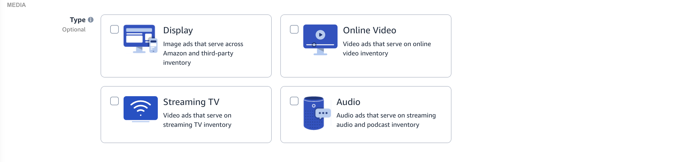 | | | | | |
| --- | --- | --- | --- | --- | --- |
| **第二栏 - Media（Type media）** | | | | | |
| 类别 | 内容 | 填写规则 | 意义 | API接口 | 备注 |
| Display | 展示广告 | 选填/多选 | 在亚马逊及第三方广告位投放的图片广告 | inventoryType：DISPLAY（官方） | 在 DSP 的层级结构中，**具体的媒体类型和广告位格式（如 Out-stream 视频、Display Banner、CTV 视频等）主要是在下一级的 Ad group（广告组）和 Creative（创意层级）中精细化确定的**。 Order 作为顶层，允许广告主在一个 Order 下同时包含多种类型的 Line Item / Ad Group。如果在此处强行限制为单一类型，反而会限制广告活动的搭建。 主要是为了给广告主和团队内部做**标签划分与报表筛选**，不直接决定具体的底层技术展现。 |
| Online Video | 线上视频 | 选填/多选 | 在在线视频广告位投放的视频广告 | inventoryType：ONLINE_VIDEO（官方） |
| Streaming TV | 流媒体平台 | 选填/多选 | 在流媒体电视广告位投放的视频广告 | inventoryType：STREAMING_TV（官方） |
| Audio | 音频平台 | 选填/多选 | 在流媒体音频和播客广告位投放的音频广告 | inventoryType（Audio，官方） |

##### 第三栏 - Goal and Optimization

| **第三栏 - Goal and Optimization** | | | | | | | |
| --- | --- | --- | --- | --- | --- | --- | --- |
| **第三栏 - Goal and Optimization** | | | | | | | |
| 类别 | | | 内容 | 填写规则 | 意义 | API接口 | 备注 |
| 第一层级 | 第二层级 | 第三层级 |
| Awareness | | |  | 单选 | Expose your brand or product tomore potential customers |  |  |
|  | **Reach** | | 曝光量 | 单选 | The number of unique users exposedfrom campaign start |  | 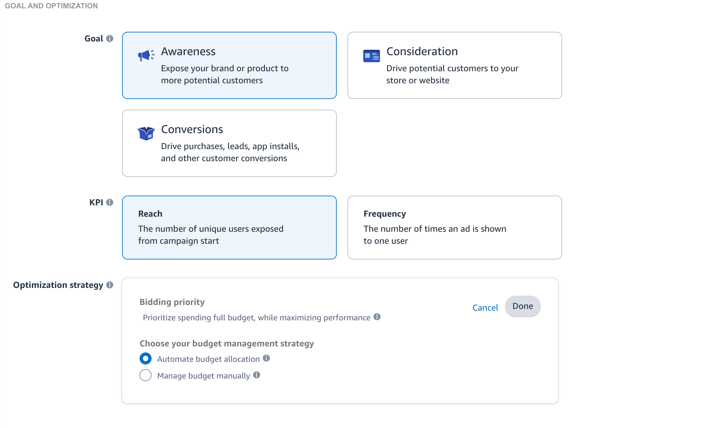 |
|  | | **Optimization strategy** | 优化策略  - Automate budget allocation - Manage budget manually | 单选 | - Automate budget allocation：   This will automatically adjust your budget toward better performing line items based on your selected KPI.  - Manage budget manually：   This allows you to manually allocate budget for line items in this order. Selecting this may result in underdelivery or underperformance. |  |  |
|  | **Frequency** | | 展示频率 | 单选 | The number of times an ad is shown to one user |  | 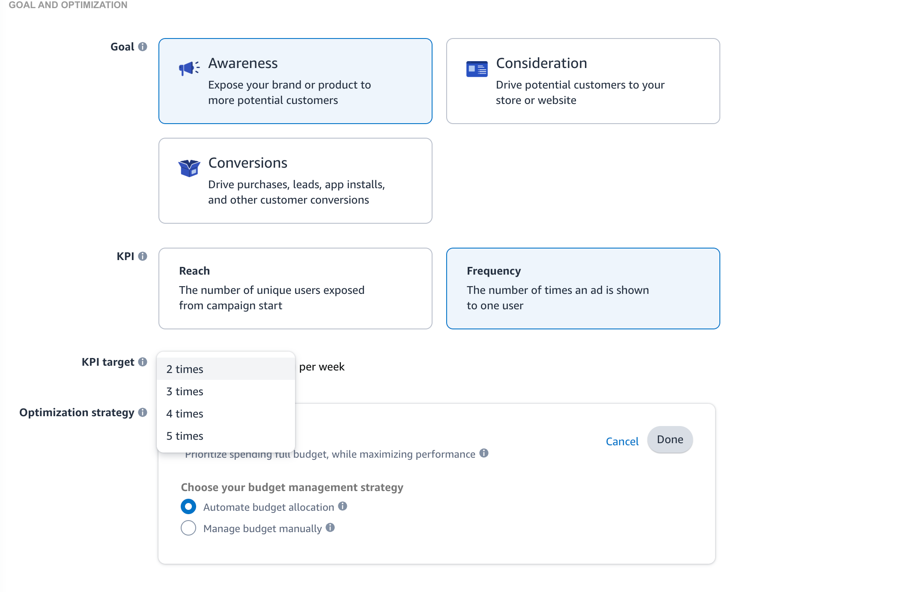 |
|  | | **Optimization strategy** | 优化策略  - Automate budget allocation - Manage budget manually | 单选 | - Automate budget allocation：   This will automatically adjust your budget toward better performing line items based on your selected KPI.  - Manage budget manually：   This allows you to manually allocate budget for line items in this order. Selecting this may result in underdelivery or underperformance. |  |  |
|  | | **KPI target** | 展示频率： | 单选 2 次/周 3次/周 4次/周 5次/周 | 展示次数设置，固定次数单选。 |  |  |
| Consideration | | | 引流 | 单选 | 吸引潜在用户跳转 |  | 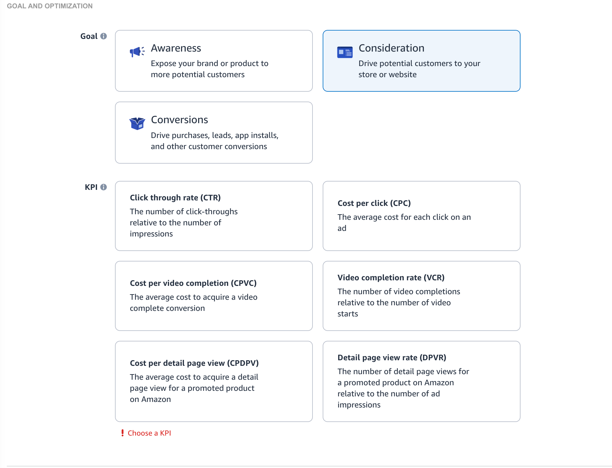 |
|  | Click through rate (CTR) | | 点击转化率 | 单选 | The number of click-throughsrelative to the number of impressions |  | 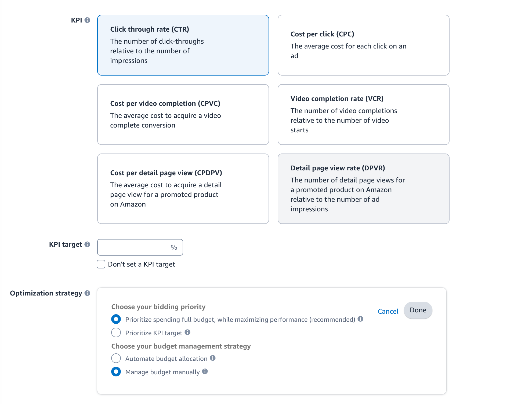 |
|  | | **KPI target** | 目标设置 | 填写/可不设置目标 |  |  |  |
|  |  | **Optimization strategy** Choose your strategies for bidding and budget management. | 优化策略 **Choose your bidding priority：**  - Prioritizespending full budget, while maximizing performance (recommended) - Prioritize KPI target   **Choose your budget management strategy：**  - Automate budget allocation - Manage budget manually | 每个小项目单选 | 依次作用  1. This optimizes bidding to deliver budget in full over achieving the KPI target. Orders using Amazon deals must prioritize spending full budget. 2. This optimizes bidding to achieve KPI target over budget delivery. If you select this, monitor the campaign regularly to ensure sufficient budget delivery. 3. This will automatically adjust your budget toward better performing line items based on your selected KPI. 4. This allows you to manually allocate budget for line items in this order. Selecting this may result in underdelivery or underperformance. |  |  |
|  | Cost per click (CPC) | | 每次点击花费 | 单选 | The average cost for each click on anad |  | 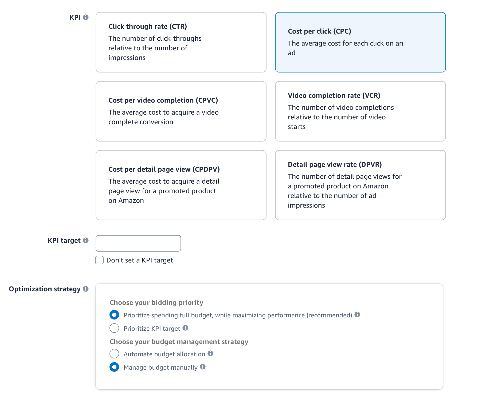 |
|  | | KPI target | 同上 |  |  |  |  |
|  | | Optimization strategy | 同上 |  |  |  |  |
|  | Cost per video completion (CPVC) | | 视频转化成本 | 单选 | The average cost to acquire a videocomplete conversion |  | 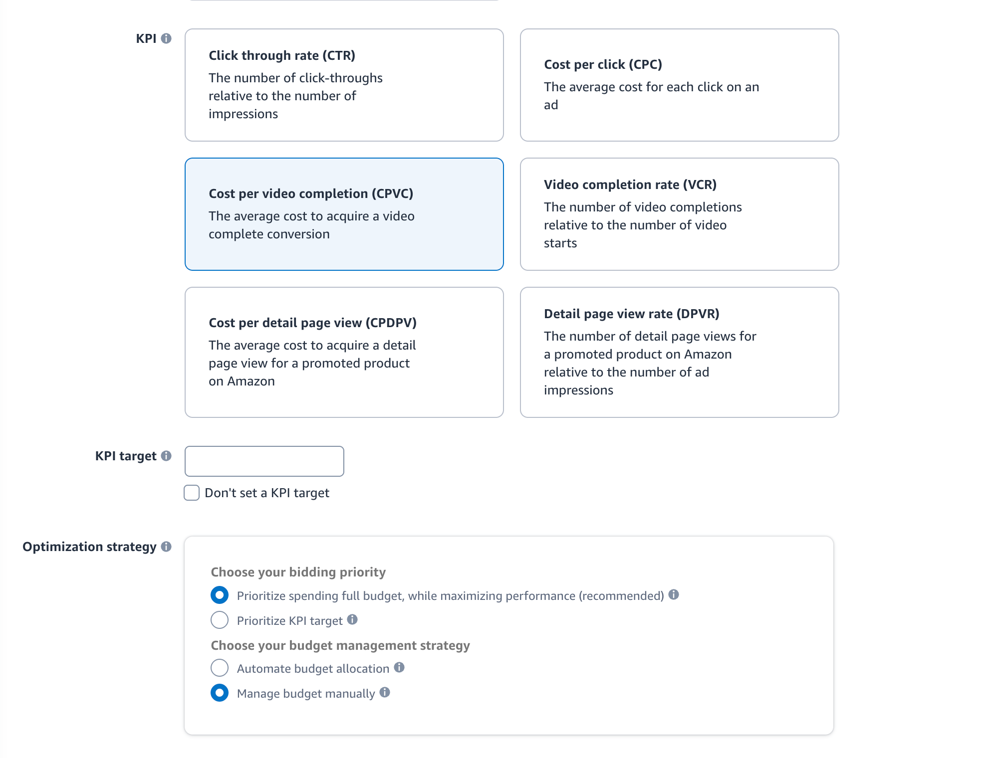 |
|  | | KPI target | 同上 |  |  |  |  |
|  | | Optimization strategy | 同上 |  |  |  |  |
|  | Video completion rate (VCR) | | 完播率 |  | The number of video completionsrelative to the number of videostarts |  |  |
|  | | KPI target | 同上 |  |  |  |  |
|  | | Optimization strategy | 同上 |  |  |  |  |
|  | Cost per detail page view (CPDPV) | | 每个详情页的花费 | 单选 | The average cost to acquire a detailpage view fora promoted producton Amazon |  | 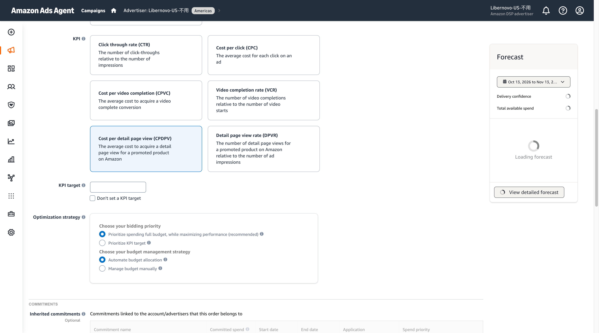 |
|  | | KPI target | 同上 |  |  |  |  |
|  | | Optimization strategy | 同上 |  |  |  |  |
|  | Detail page view rate (DPVR) | | 详情页观看率 | 单选 | The number of detail page views fora promoted product on Amazonrelative to the number of ad impressions |  | 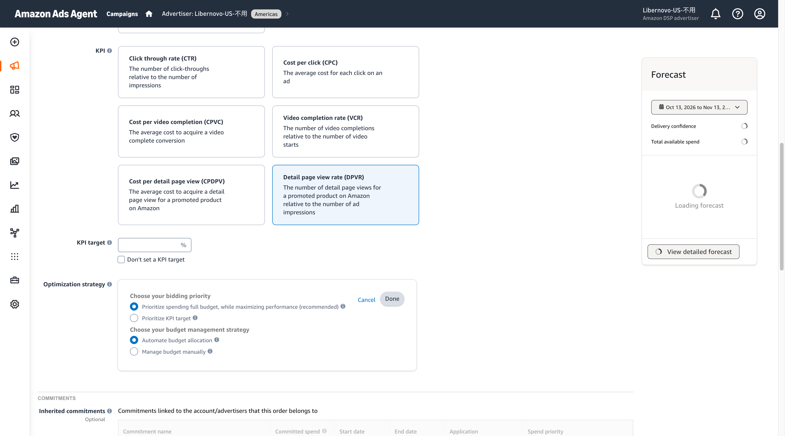 |
|  | | KPI target | 同上 |  |  |  |  |
|  | | Optimization strategy | 同上 |  |  |  |  |
| conversions | | | 转化 | 单选 | Drive purchases, leads, app installsand other customer conversions |  |  |
|  | Return on ad spend (ROAS) | | 支出回报率 | 单选 | 广告支出和平均回报率 |  |  |
|  | | KPI target | 同上 |  |  |  |  |
|  | | Optimization strategy | 同上 |  |  |  |  |
|  | Total ROAS (T-ROAS) | | 总平均回报率 |  | 所有产品的平均回报率 |  |  |
|  | | KPI target | 同上 |  |  |  |  |
|  | | Optimization strategy | 同上 |  |  |  |  |
|  | Cost per action (CPA) | | 平均行为花费 |  | 所有行为的花费 |  |  |
|  | | KPI target | 同上 |  |  |  |  |
|  |  | Optimization strategy | 同上 |  |  |  |  |
|  | Combined ROAS (C-ROAS) | | 综合ROAS |  | 站内站外所有ROAS数据 |  | 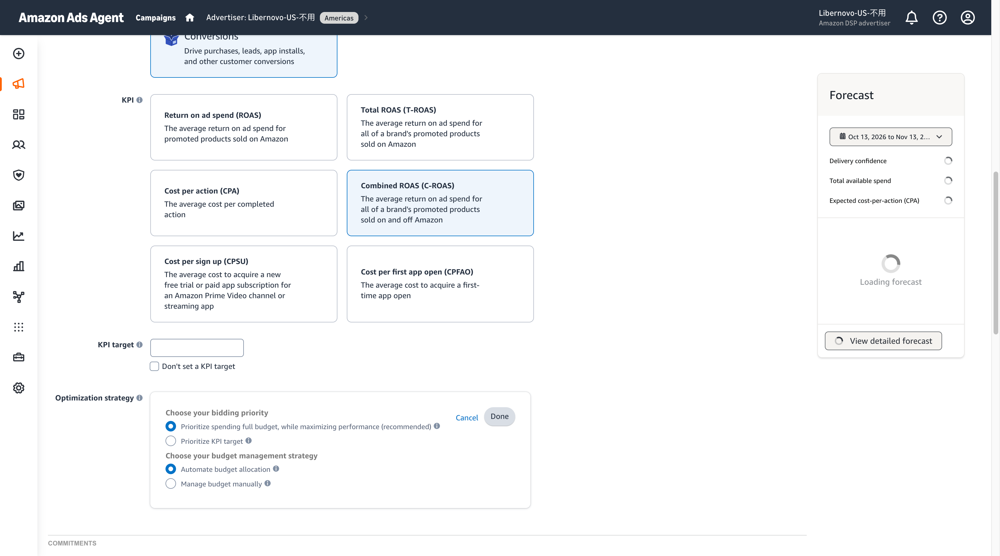 |
|  | | KPI target | 同上 |  |  |  |  |
|  | | Optimization strategy | 同上 |  |  |  |  |
|  | Cost per sign up (cPsU) | | 注册花费 |  | The average cost to acquire a newfree trial or paid app subscription foran Amazon Prime Video channel orstreaming app |  |  |
|  | | KPI target | 同上 |  |  |  |  |
|  | | Optimization strategy | 同上 |  |  |  |  |
|  | Cost per first app open (CPFAO) | | 首次打开应用成本 |  | The average cost to acquire a first-time app open |  |  |
|  | | KPI target | 同上 |  |  |  |  |
|  | | Optimization strategy | 同上 |  |  |  |  |

##### 第四栏 - Commitments

| **第四栏 - Commitments**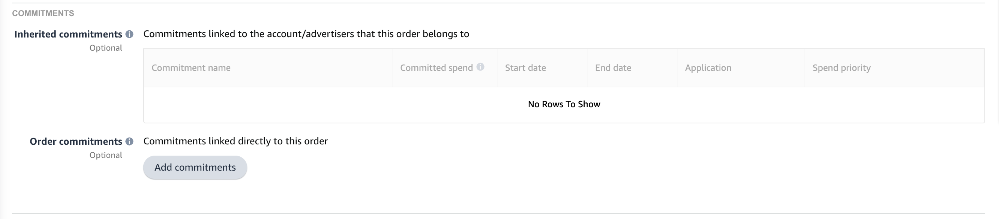 | | | | | |
| --- | --- | --- | --- | --- | --- |
| **第四栏 - Commitments** | | | | | |
| 类别 | 内容 | 填写规则 | 意义 | API接口 | 备注 |
| **Inherited commitments** | Commitments linked to the account/advertisers that this order belongs to | 选填 | To edit these commitments, go to Amazon DSP > Inventory > Commitments. | Commitments（以官方为准） |  |
| **Order commitments** | Commitments linked directly to this order | 选填 | Commitments that appear here are linked to one advertiser and set to "Selected orders ". To edit these, go to Amazon DSP > Inventory > Commitments. | Commitments（以官方为准） |  |
| Add commitment | **添加Order commitments具体内容** | 填写项 |  | Commitments（以官方为准） | **Order commitments交互层级** |

##### 第五栏 - Budget and flights

| **第五栏 - Commitments**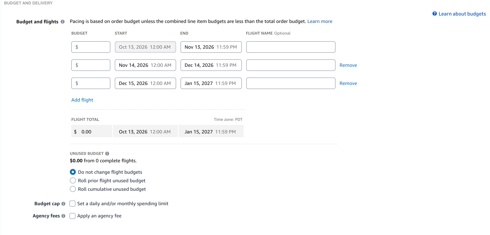 | | | | | |
| --- | --- | --- | --- | --- | --- |
| **第五栏 - Commitments** | | | | | |
| 类别 | 内容 | 填写规则 | 意义 | API接口 | 备注 |
| **Budget and flights** | 预算分配 字段： **Budget** **Start（开始时间）** **End（结束时间）** **Flight name（预算名称）（玄天）** | 必填 填写 & 时间序列 | 预算分配 | flights[].budgetAmount（官方） | 业务侧通常以一个月为周期便于管理。 |
| **Flight Total** | 管理展示预算总结 | 系统总结 | 展示 总金额 起止时间 时区 | 系统展示（非创建接口） | 管理信息 |
| **Unused budget** | 预算流转 可选项：  - Do not change flight budgets - Roll prior flight unused budget - Roll cumulative unused budget | 单选 | Budget rollover can take up to 1 day to take effect. | 预算流转（以官方为准） | 至少一天生效 |
| **Budget cap** | 预算限额 | 勾选 选项：Set a daily and/or monthly spending limit | A service fee that is subtracted from budget. Agency fee is applied as a percent of the total budget or as a flat fee subtracted from the total budget. Agency fee will not be editable if the order has one or more line items. | flights[].budgetAmount（官方） |  可增加共两个限额，必须分别是日预算上限和日预算上限 |
| **Agency fees** | 代理商返点 | 勾选 选项： Apply an agency fee | A service fee that is subtracted from budget. Agency fee is applied as a percent of the total budget or as a flat fee subtracted from the total budget. Agency fee will not be editable if the order has one or more line items. | agency fee（官方创建请求体） | 勾选，业务填写代理费，百分比。 |

##### 第六栏 - Conversion tracking

| **第六栏 - Conversion tracking** | | | | | |
| --- | --- | --- | --- | --- | --- |
| **第六栏 - Conversion tracking** | | | | | |
| 类别 | 内容 | 填写规则 | 意义 | API接口 | 备注 |
| **Products** | 填写需要增加的项目 | 上传附件或填写，见附属层级 | 关联相关产品 | conversionTracking/products（官方） |  |
| Product ASINs | 产品编码 | 必填 | 产品关联信源 A product's ASIN can be found in the product details section of the product's detail page. Separate ASINs with a space, comma, tab, or new line. | conversionTracking/products（官方） | **Products附属层级** |
| Set as featured | 设置特征 | 单选，必填 可选项： Yes, with variations NO yes | A featured ASIN is a specific product that’s promoted in creatives within this order. Tracking non-featured ASINs or variations, in addition to featured and parent ASINs, will ensure proper conversion metrics and prevent data loss that is not recoverable once a campaign starts. | productAssociation：FEATURED/FEATURED_WITH_VARIATION（官方） | **Products附属层级** |
| Amazon domain | 亚马逊站点 | 多选 | 亚马逊站点 | productTrackingList[].domain（官方） | **Products附属层级** |
| Automatically create responsive ads | 自动创建响应广告 | 开启项，选填 | This will automatically create a responsive eCommerce (REC) creativefor eligible featured ASINs You can update the creative any time inthe creative's settings. |  |  |
| **SKAdNetwork** |  | 选填 | Add your iOS app in Events Manager and turn on SKAdNetwork measurement to measure and optimize conversions. | 以官方为准（后台测试中） | 后台测试中 |
| **Off-Amazon conversions** | 站外转化 | 跳转填写 | Associate off-amazon conversions to your order to track performance metrics. | conversionDefinitionAssociations（官方） | 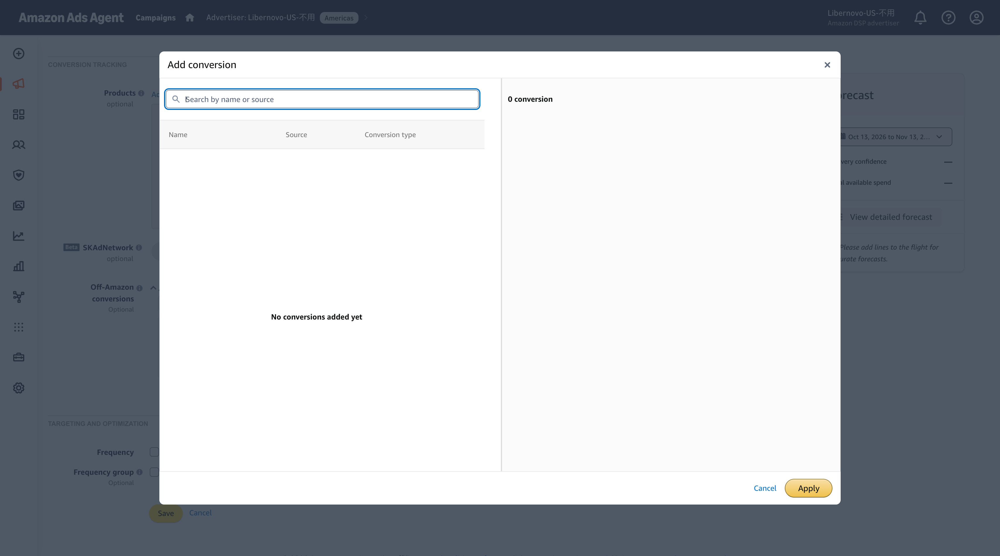 检索关联 |

##### 第七栏 - Targeting and optimization

| **第七栏 - Targeting and optimization**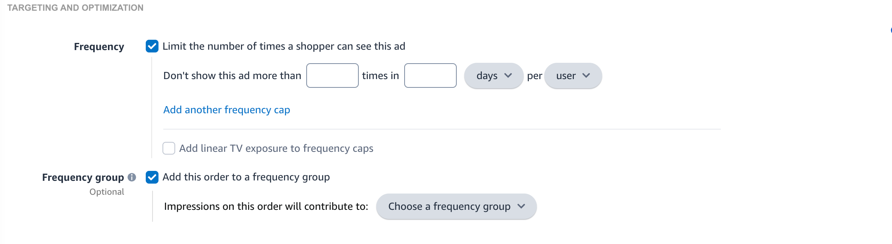 | | | | | |
| --- | --- | --- | --- | --- | --- |
| **第七栏 - Targeting and optimization** | | | | | |
| 类别 | 内容 | 填写规则 | 意义 | API接口 | 备注 |
| **Frequency** | 频率 | 选择性勾选，状态填写 | 频率设置 | frequencies（官方）/频次目标 | 允许最多3条限制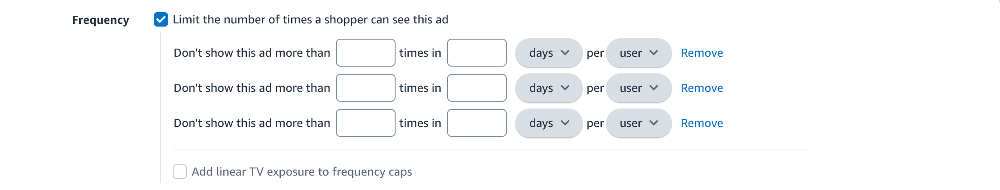 |
| **Frequency group** | 频率组 | 选择性勾选，可选，关联检索 | Only active frequency groups can be added to an order. | frequencies（官方）/频次目标 |  |

#### 第二步：建立 Line items
新建 line 需要关联已创建的 order（需要 API 接口数据回拉）。
> 配置 Line item，不同的展示页面关联配置略有区别；人群和素材单独创建。
##### 第一步基础设置

| **创建Line item** | | | | | |
| --- | --- | --- | --- | --- | --- |
| **创建Line item** | | | | | |
| 类别 | 内容 | 填写规则 | 意义 | API接口 | 备注 |
| **Advertiser** | 广告主 | 自动关联 | 广告主账号关联 |  |  |
| **Order** | 选择一存在order | 选择 | 关联order |  | 需要数据会拉 |
| **第一栏**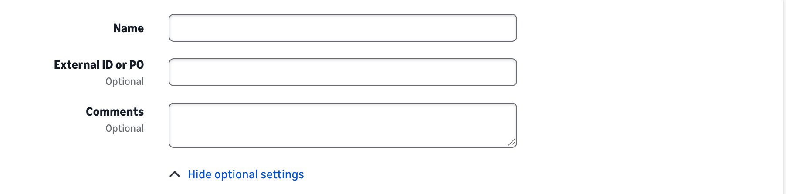 | | | | | |
| 类别 | 内容 | 填写规则 | 意义 | API接口 | 备注 |
| Name | Name | 必填 | Line 名称 | adGroup/adCreative name（官方创建接口） | 有自己的组内规则，需要看怎么实现。多维表格是按照强关联组装。agent实现方式需考虑稳定和准确性 |
| **External ID or PO** | 订单号 | 选填 | 亚马逊向您发送每月广告账单（Invoice）时，账单上会显示此 PO 号码，方便您的财务部门精准匹配预算与核销。 | PO number 字段（官方） |  |
| Comments | 评论 | 选填 | 用于记录该 Order 的背景信息、策略方向、预算变更原因或团队协作注意事项。该内容仅在后台供有权限的账户操作人员查看，**不会展示给消费者**。 | comments 字段（官方创建请求体） |  |

##### Media Type - Display

| **第一栏** | | | | | |
| --- | --- | --- | --- | --- | --- |
| **第一栏** | | | | | |
| 类别 | 内容 | 填写规则 | 意义 | API接口 | 备注 |
| Name | Name | 必填 | Line 名称 | adGroup/adCreative name（官方创建接口） | 有自己的组内规则，需要看怎么实现。多维表格是按照强关联组装。agent实现方式需考虑稳定和准确性 |
| **External ID or PO** | 订单号 | 选填 | 亚马逊向您发送每月广告账单（Invoice）时，账单上会显示此 PO 号码，方便您的财务部门精准匹配预算与核销。 | PO number 字段（官方） |  |
| Comments | 评论 | 选填 | 用于记录该 Order 的背景信息、策略方向、预算变更原因或团队协作注意事项。该内容仅在后台供有权限的账户操作人员查看，**不会展示给消费者**。 | comments 字段（官方创建请求体） |  |
| **Type - Display** Image ads that serve across Amazon and third-party inventory | | | | | |
| **Media**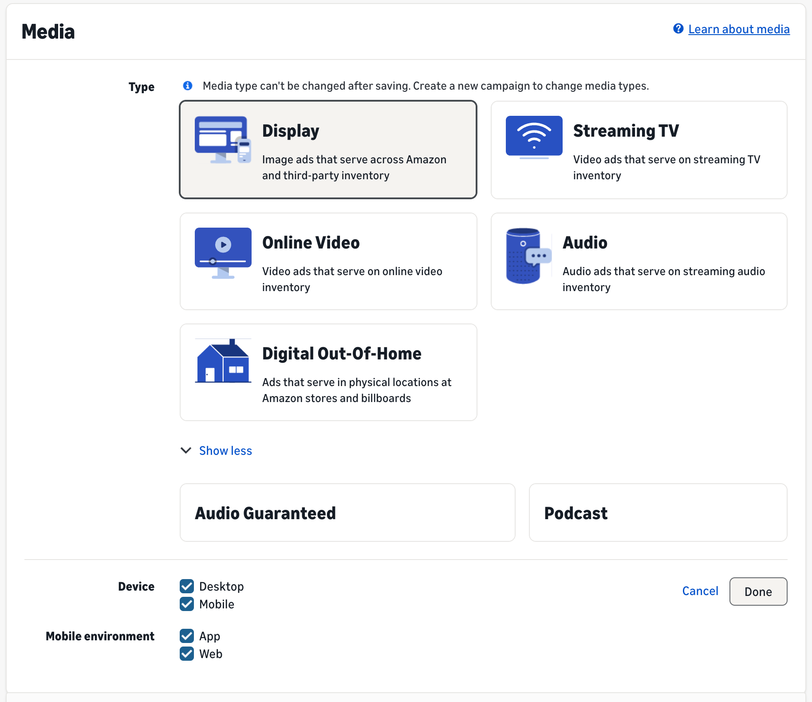 | | | | | |
| 类别 | 内容 | 填写规则 | 意义 | API接口 | 备注 |
| Device | 设备 字段： Desktop Mobile | 必填，勾选 | 投放设备 | deviceTarget（官方 targets） | 至少选一个 |
| Mobile environment | 投放端： 字段： App Web | 必填，勾选 | 投放端 | deviceTarget 移动环境（官方） | 至少选一个 |
| **Products and Services** | | | | | |
| 类别 | 内容 | 填写规则 | 意义 | API接口 | 备注 |
| **Category** | 投放类别 | 层级勾选 | Choose the category of the products and services you're advertising | advertisedProductCategoryIds（官方 Discovery） | 平台提供数据 |
| **Inventory**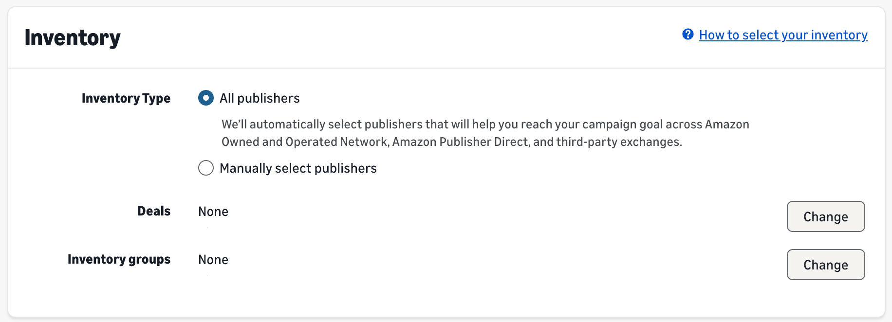 | | | | | |
| 类别 | 内容 | 填写规则 | 意义 | API接口 | 备注 |
| Inventory Type | 渠道类型： 字段： 全部渠道 自定义渠道 | 单选/配置 | 渠道选择 | inventorySourceTarget（官方） | All publishers： We’ll automatically select publishers that will help you reach your campaign goal across Amazon Owned and Operated Network, Amazon Publisher Direct, and third-party exchanges. Manually select publishers： 自定义选择。 是否是 |
| **Deals** | 优惠 | 后台选取 | 优惠活动选择 | deals 定向（官方） |  |
| Inventory groups | 渠道组 | 后台选取 | 自定义打包索引 | inventory groups 定向（官方） |  |
| **Targeting**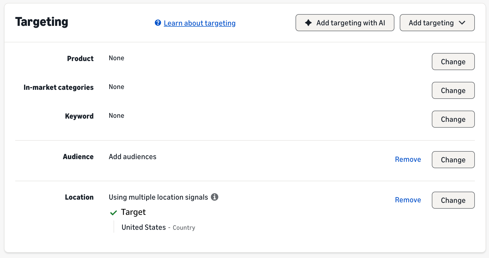 | | | | | |
| 类别 | 内容 | 填写规则 | 意义 | API接口 | 备注 |
| **Add targeting** 后台添加后，编辑。具体如下 | 添加targeting | 多选加载，取消remove | 添加targeting类目 | targets 端点（官方：POST /dsp/v1/targets） | 类别太多了，挑重点开发。如果不选会怎么样。需要确认下会用到哪些？ |
| Behavior -  Audience | 人群包 | 后台检索添加 | 关联人群包 可多选 涵盖： **包含人群** **排除人群** | audienceTarget（官方：POST /dsp/v1/targets） | 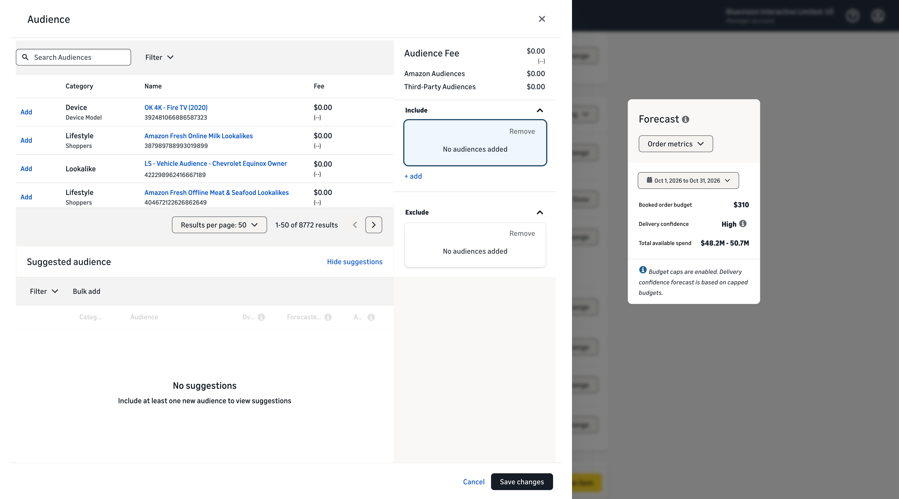 |
| Behavior -  Location | 地点 涵盖选项： **Only use real-time location（勾选）** **Add locations：** Location（地区） Radius（半径）（beta）版本 **Add location groups；** **Geographic insights and activation (GIA)（新增，自定义位置索引）** | 后台检索添加 | 使用多个位置，包括实时位置和家庭位置。 可多选 涵盖： **包含地区** **排除地区** | locationTarget（官方；/dsp/geoLocations） | 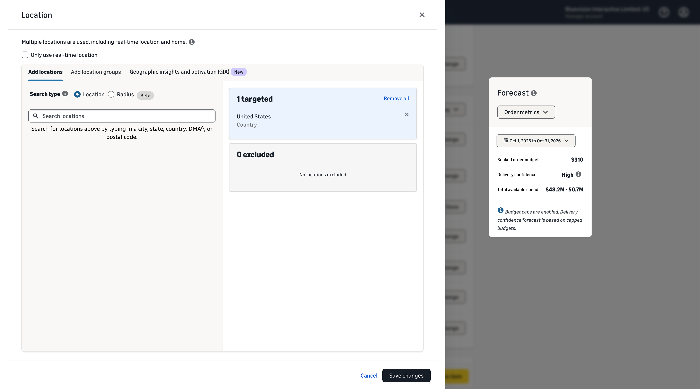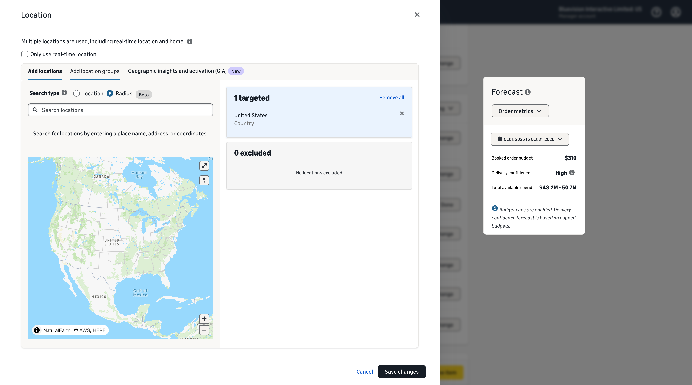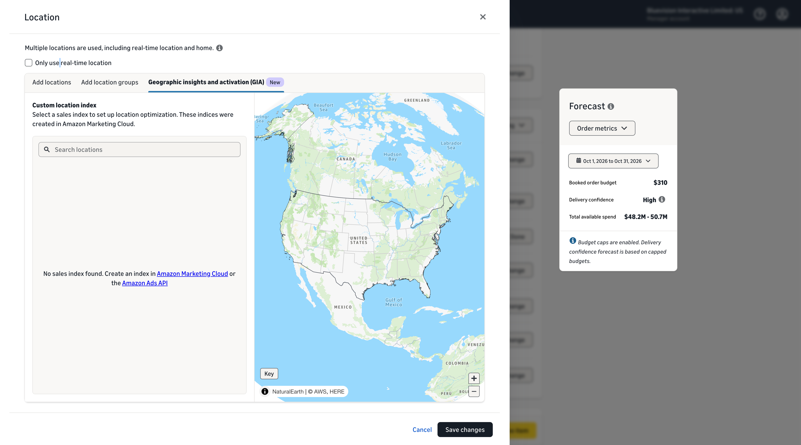 |
| Behavior -  Daypart | 投放时间选择 **Time zone（下拉单选）：** View's time zone Account's time zone Schedule： 星期X时刻 | 后台检索 | 选择投放展示时间配置 | dayPartTarget（官方） | 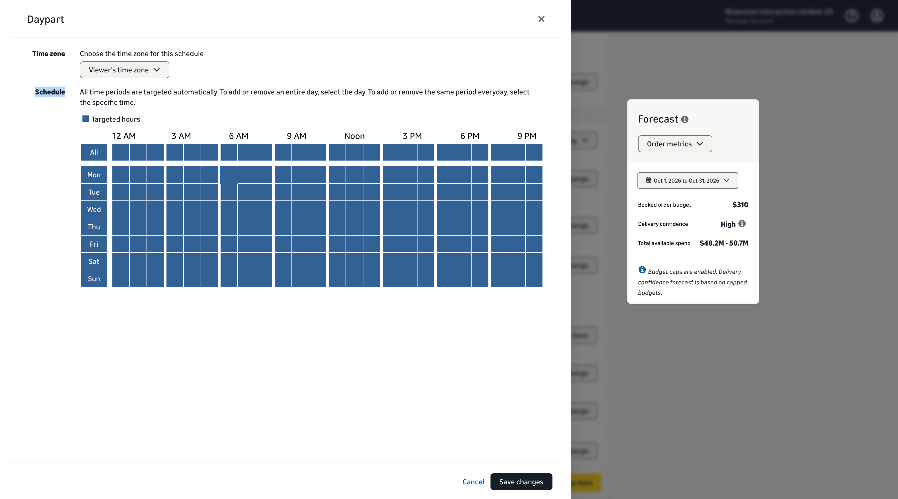 |
| Technology - Device | 设备选择 iPhone iPad Android Kindle Fire Kindle Fire HD | 多选 | 投放设备定位 | deviceTarget（官方 targets） | 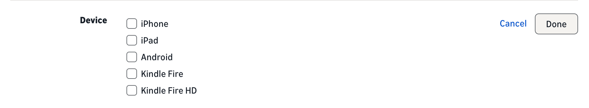 默认状态下是什么？全选？ |
| Technology - Mobile OS | 设备系统 iOS Android | 多选 | 投放的设备系统 | 以官方为准 |  |
| Technology - Orientation | 排版选项 Any（任何） Portrait（竖向） Landscape（横向） | 单选 | 素材展示的排版方向 | 以官方为准 | 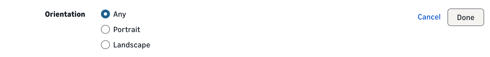 |
| Placement - Domain | 域名定向 涵盖： Target（目标域名） Exclude（排除域名） | 后台操作 上传csv、列表选择、自定义输入 勾选项 Use advertiser's domain targeting in addition to the line item's domain targeting below | 投放域名定向 | domainTarget（官方） | 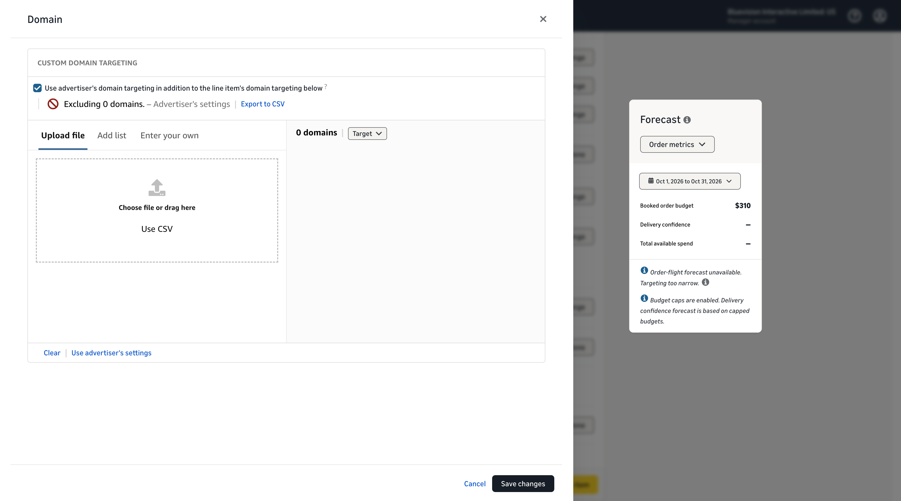 |
| Placement -  **Contextual** （Contextual Targeting has migrated to Product, Category and Keyword.） | - | - | - | advertisedProductCategoryIds（官方 Discovery） |  |
| **Product** | 产品 涵盖： In-Market： **Suggested（**Suggested products are products associated for conversion tracking.）； **Search；** **Enter list；** 勾选项： **Only use contextual signals**（Multiple targeting signals are used, including behavioral and contextual.） 开启项： Include related products（Complements and automatic targeting are no longer available. You can add products from the suggested section and include related products for similar results.） **Exclusions：** 同上 | 后台操作 | 产品定向 | productTarget（官方） | 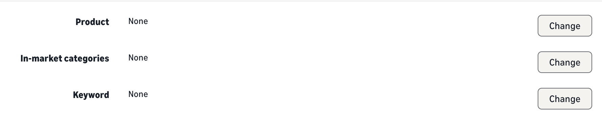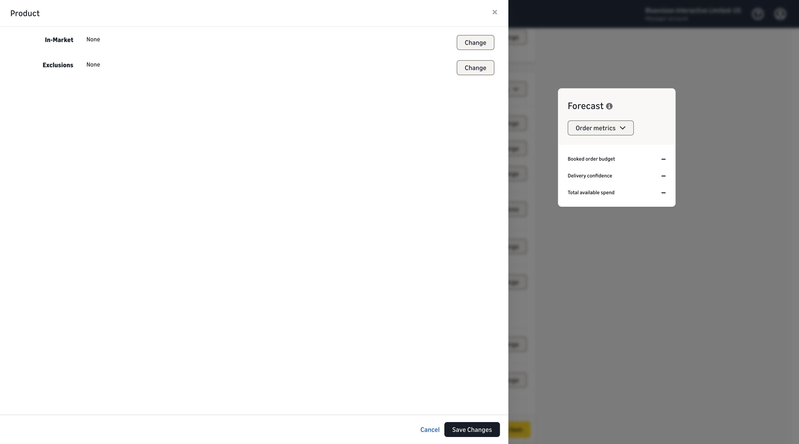 **In-market**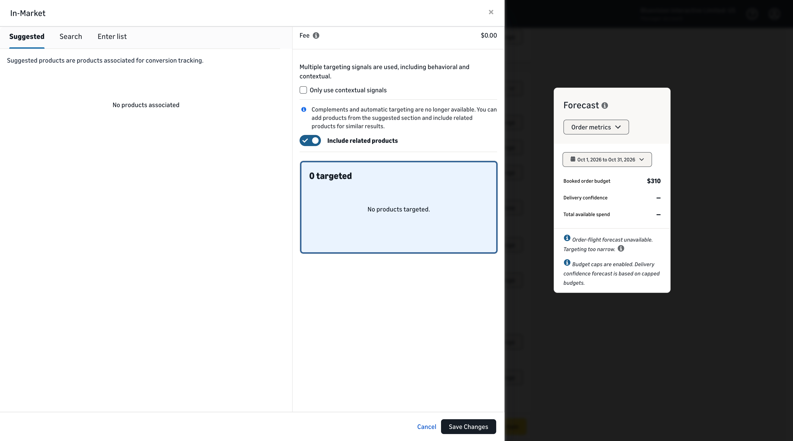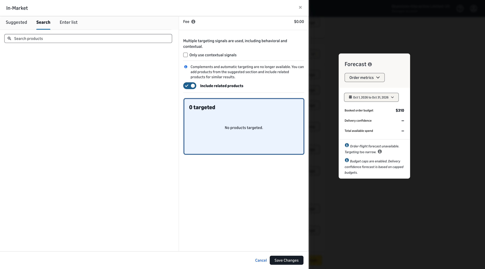 **Exclude**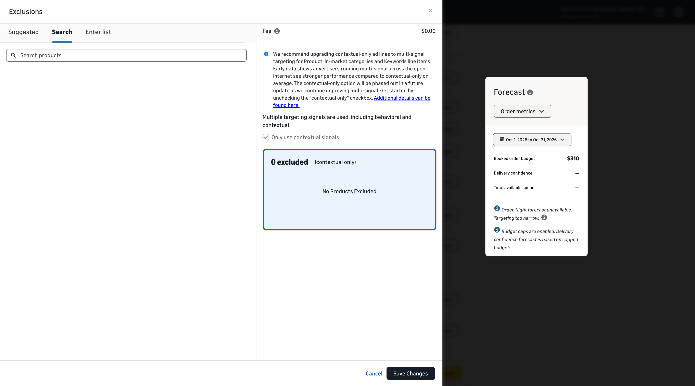 |
| In-market categories | 市场类别 包含： Targeted（目标） exclude（排除） 勾选项： 上下文信号 | 后台加载 | 市场类别定位 | productCategoryTarget（官方） | 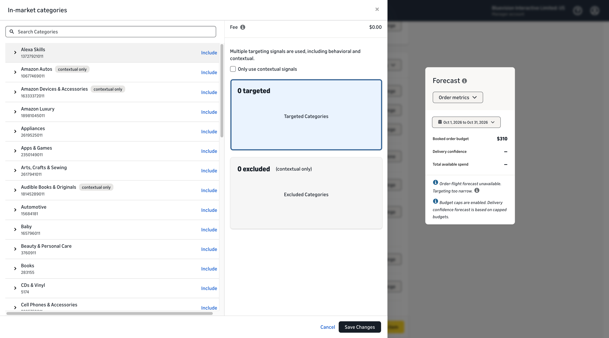 |
| **Keyword** | 关键词 包含： 检索 倒入 勾选项： 上下文信号 |  | 关键词定位 | keywordTarget（官方） | 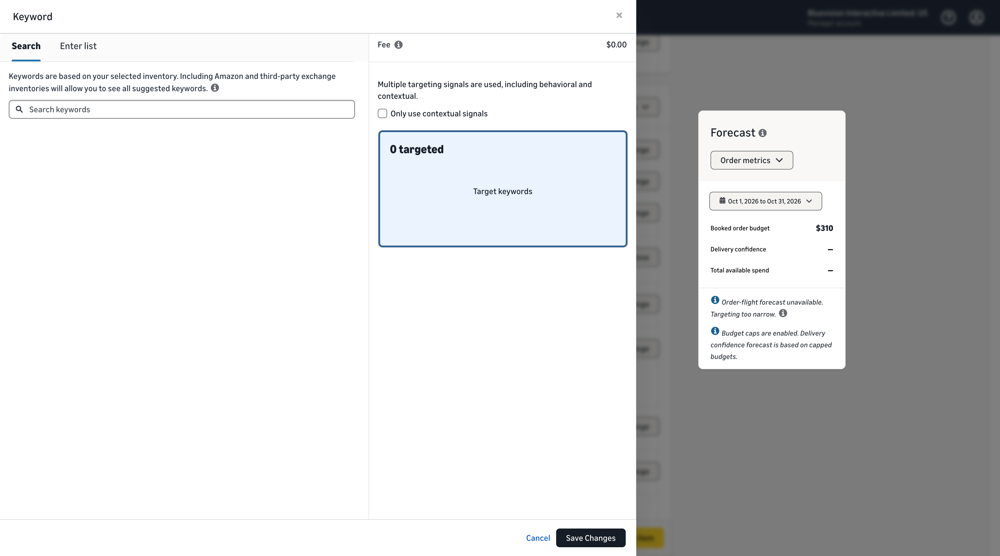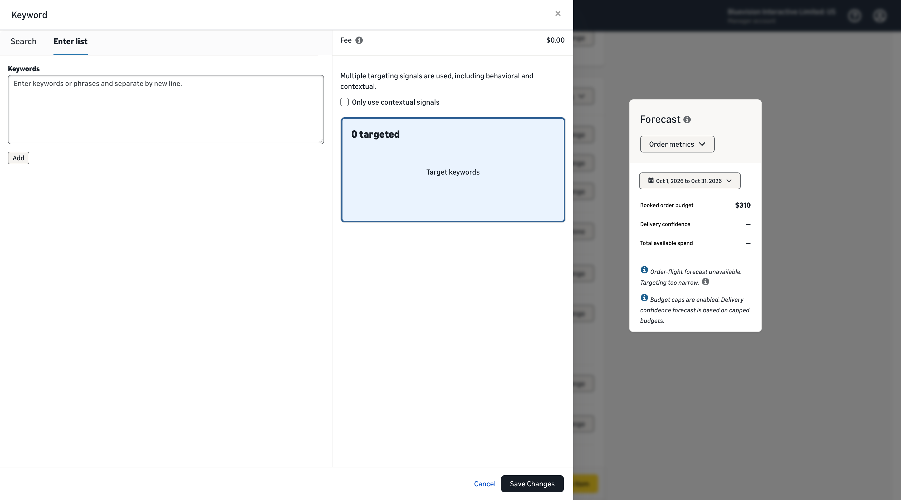 |
| Placement -  Viewability | 单选 **allow all（greatest reach）；70% and greater (most viewable)；60% and greater；50% and greater；40% and greater；Upto 40%。** | 下拉选项 | These are predictions based on machine learning and aren’t guaranteed. Selecting a higher percentage limits overall reach. | amazonViewability（官方 adGroups targetingSettings） | 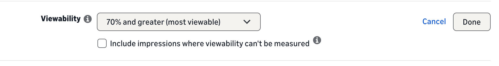 除allow all外，均有可选项，如下：Include impressions where viewability can't be measured 作用 They don't have viewability rates for all traffic. Don't select this if high viewability is your goal. |
| Placement -  Mobile app | 手机软件 涵盖： **Add Mobile Apps；** **Add Mobile App Groups** 及 **Include；exclude** | 后台检索生成 | 手机软件定位 | mobileAppTarget（官方） | 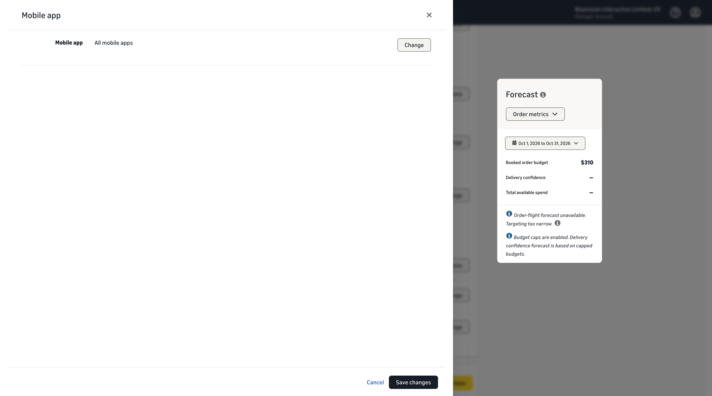 |
| Content -  language | 语言定位 Use language targeting | 勾选 | 选择定向语言 | contentTarget（以官方为准） |  Language Targeting enables targeting supply content language. When enabled, the line item will automatically target supply language based on the creative language selected. This feature is only available for Amazon Retail, Amazon Publisher Direct and Third Party exchange supply. Please visit the help center for more information. |
| **Content - Brand suitability（beta）** | 品牌适用性 涵盖： Inventory tier： **Expanded（Maximize reach with all eligible inventory.）；Standard（Balance reach and brand suitability.）；Restrictive（Balance reach and brand suitability.）** 勾选项**Content exclusion categories**： **Content exclusion categories：Accidents, disasters, and tragedies；Weapons；Gambling；Blood, gore, and violence；Crime；Shock and horror；Profanity；Highly debated social issues；Politics；Sexual references and suggestive；Alcohol and related products；Tobacco and related products；Drug reference or use；Religious content；Unrated media content** | 后台操作 |  | contentTarget（以官方为准） |  |
| Position - **Fold position** | 折叠位置定位 包含 Above the fold；Below the fold | 勾选、多选 | 头部尾部展示为定位 | 以官方为准（Amazon inventory 不支持） |  Amazon inventory doesn't currently support fold position targeting. |
| Position - Native content position | 原生内容定位，包含： In-article In-feed Peripheral Recommendation | 勾选、多选 | 内容定位 | 以官方为准（Amazon inventory 不支持） |  Amazon inventory doesn't currently support fold position targeting. |
| Verification - hird-party pre-bid | 第三方平台预演 内容见截图 | 后台操作 | 第三方平台数据预演 |  | 现阶段不需要，在此不赘述。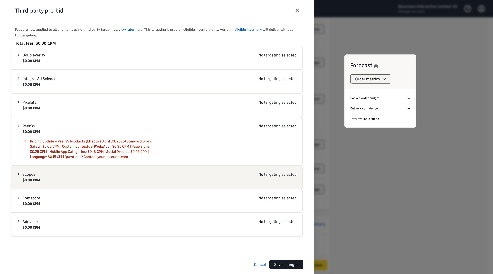 |
| **Delivery**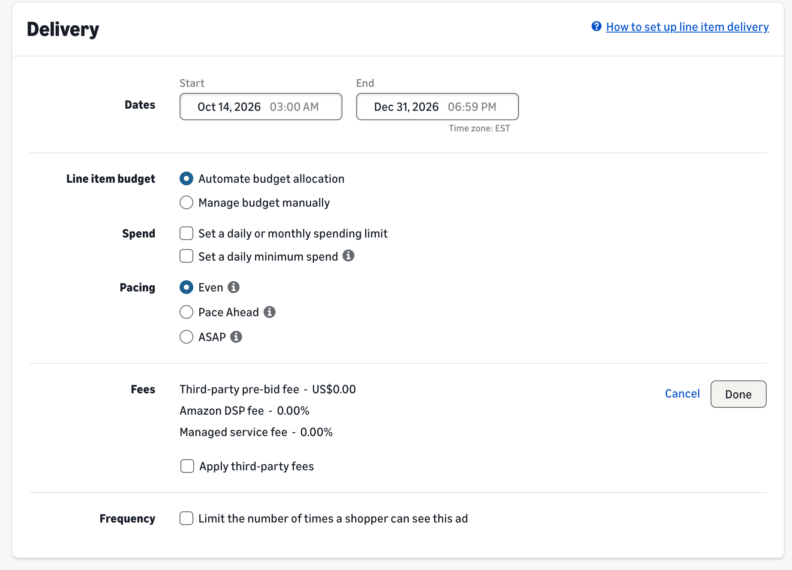 | | | | | |
| 类别 | 内容 | 填写规则 | 意义 | API接口 | 备注 |
| Dates | 日期 涵盖： 开始时间；结束时间 | 日期选择和时刻填写 | 投放时间设定 | startDateTime/endDateTime（官方） | 需要明确有order的时间的区别。 注意时区的关联性 |
| Line item budget | Line item预算 包含： Automate budget allocation；Manage budget manually | 单选+填写 Manage budget manually需填写金额，同时 Spend层级Set a daily minimum spend选项不可选 | 预算类型设置 | budgetAmount / automateBudgetAllocation（官方） | 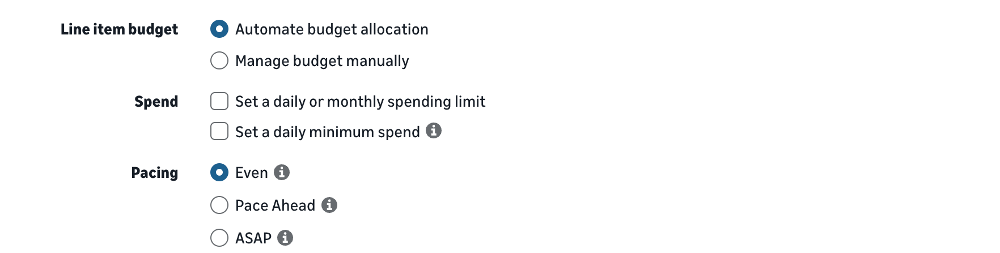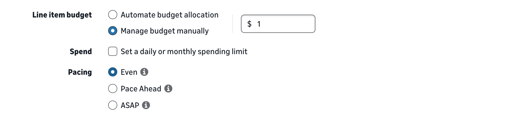 |
| Spend | 花费 包含： Set a daily or monthly spending limit（最多选两个，且类型不同）： Daily limit + 预算 Month limit + 预算 Set a daily minimum spend（金额设置） | 单选和填写 | 花费限额设置 | budget cap：daily/monthly spending limit（官方） | 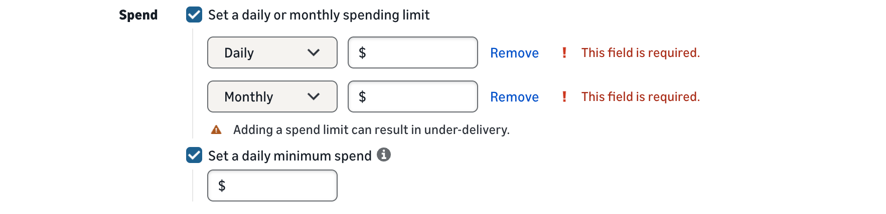 |
| Pacing | 费用 包含： Even（周期类均衡投放） Pace Ahead（可比每日预算多25%） ASAP（全部预算立即投入使用）（需单独设置，日程flight不建议选） | 单选 | 周期内每个阶段费用的控制 | pacing.deliveryProfile（官方） | 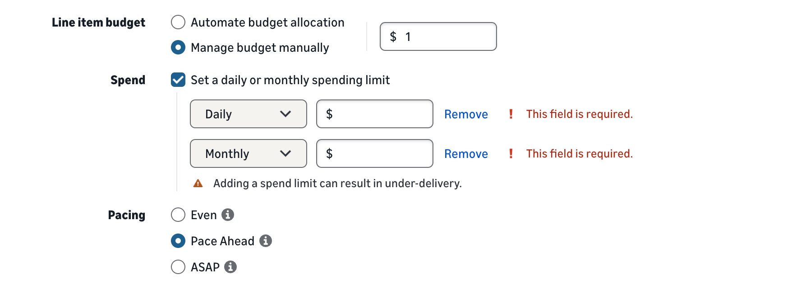 |
| Fees | 费率 包含： Apply third-party fees Provider name（单选）: Integral Ad Science；DoubleVerify Doubleclick Campaign Manager comScore CPM1 CPM2 CPM 3 CPM（填写）：金额 Fee allocation（单选）: Added on top of budget；Deducted from the budget | 勾选后填写 | 费用控制 | fees（官方） | 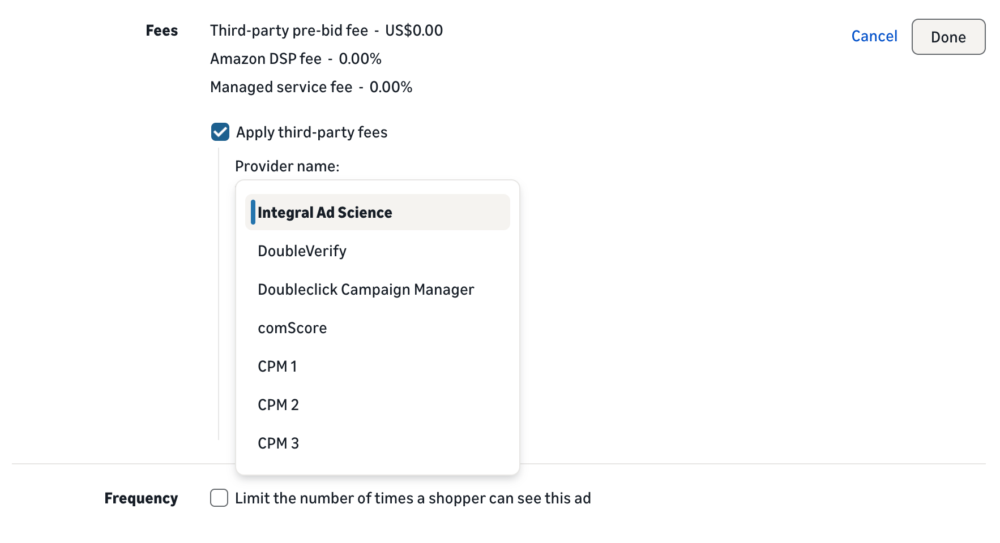 |
| Frequency | 频率 包含： Limit the number of times a shopper can see this ad（勾选） 填写参数结构件见备注 | 勾选，填写 | 频率控制 | frequencies（官方）/频次目标 | 可新增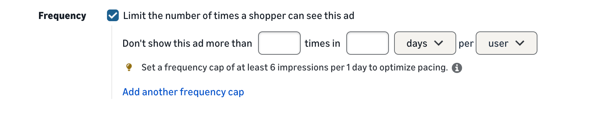 跟之的频率参数的区别。 |
| **Bidding** | | | | | |
| 类别 | 内容 | 填写规则 | 意义 | API接口 | 备注 |
| Bidding priority | Use order priority –  Prioritize spending full budget, while maximizing performance | - | 出价优先级定义了亚马逊广告如何根据展示次数达到所选目标 KPI（例如点击、转化、购买等）的概率，代表广告主确定出价。 | optimization.bidStrategy（官方） | display中无填写内容 |
| Maximum average CPM | 最大平均CPM 包含： Automatically optimize Manually set：需填写金额 | 单选 | 最大平均CPM限制 | bid（官方） |  有最低限制，低于限制容易失败，需调研 |
| Bid adjustments | 竞价调整 | 可选项，后台操作，固定模版填写上传。 | 竞价调整功能允许您在竞价时根据特定条件上调或下调出价。 | bid adjustments（以官方为准） |  |
| Priority adjustments | **优先级调整** | 可选项，后台操作，固定模版填写上传。 | 优先级调整功能允许您在竞标时根据特定标准调整优先级。 | priority adjustments（以官方为准） | 系统默认不进行优先级调整 |

| **Media - Display** | | | | | | | |
| --- | --- | --- | --- | --- | --- | --- | --- |
| **Media - Display** | | | | | | | |
| **板块** | **附属层级** | **内容** | | | |  |  |
| **Device（2个）** | | Desktop | Mobile |  |  |  |  |
| **Mobile environment（2个）** | | App | Web |  |  |  |  |
| **Products and Services（1个）** | | Category |  |  |  |  |  |
| **Inventory（3个）** | | Inventory Type | Deals | Inventory groups |  |  |  |
| **Targeting（6大类，16小类）** | Behavior（4个） | Multi-signal | Audience | Location | Daypart |  |  |
| Technology（3个） | Mobile OS | Device | Orientation |  |  |  |
| Placement（4个） | Domain | Contextual | Viewability | Mobile app |  |  |
| Content（2个） | Language | Brand suitability |  |  |  |  |
| Position（2个） | Fold position | Native content position |  |  |  |  |
| Verification（1个） | Third-party pre-bid |  |  |  |  |  |
| **Delivery（6个）** | | Dates | Line item budget | Spend | Pacing | Fees | Frequency |
| **Bidding（4个）** | | Bidding priority | Maximum average CPM | Bid adjustments | Priority adjustments |  |  |

##### Media Type - Online Video

| **Type - Online Video** Video ads that serve on online video inventory | | | | | |
| --- | --- | --- | --- | --- | --- |
| **Type - Online Video** Video ads that serve on online video inventory | | | | | |
| **Media** **有变化 - 除投放类型外，无Device（迁移到了targeting - technology - device）、Mobile environment（迁移到了targeting - technology - Mobile environment）设置** | | | | | |
| Products and Services（无变化）（见display板块） | | | | | |
| Inventory - 新增Automatic deal selection | | | | | |
| 类别 | 内容 | 填写规则 | 意义 | API接口 | 备注 |
| Inventory Type | 渠道类型： 字段： 全部渠道 自定义渠道 | 单选/配置 | 渠道选择 |  | All publishers： We’ll automatically select publishers that will help you reach your campaign goal across Amazon Owned and Operated Network, Amazon Publisher Direct, and third-party exchanges. Manually select publishers： 自定义选择。 是否是 |
| **Deals** | 优惠 | 后台选取 | 优惠活动选择 |  |  |
| Inventory groups | 渠道组 | 后台选取 | 自定义打包索引 |  |  |
| Automatic deal selection（Beta） | 自动折扣选择 包含： Automatically select and optimize deals based on your campaign goal and targeting criteria.（勾选） **Deal eligibility（可选）（跳转后台操作）：** **Supply sources：All (default)；** Amazon owned and operated； Open internet； Choose specific supply sources（后台添加，见图） **Publicly listed deals：** Include all deals (default)； Exclude publicly listed deals； Include only publicly listed deals | 勾选、填写 | 根据您的营销目标和定位条件，自动选择和优化优惠活动。 |  |  |
| Targeting - 有改动，见总结，本章只展示变动项，同项见display篇 | | | | | |
| 类别 | 内容 | 填写规则 | 意义 | API接口 | 备注 |
| Technology - Device type | 设备类型 Desktop Mobile | 勾选、多选 | 定向投放的设备类型 |  |  |
| Technology Mobile environment | 设备环境 Web App | 勾选、多选 | 定向投放的设备环境 |  |  |
| Placement -  Video content duration | 视频时长 Short-form (0 – 10 min) Mid-Length (10 – 30 min) Long-form (30 – 60 min) Extended (60+ min) | 勾选、多选 | 投放的视频内容时长 |  |  Amazon inventory doesn't currently support video content duration targeting. |
| Placement - StreamingTVappblocking |  |  |  |  | (该类目不可选) |
| Content - Content | 内容 包含： **Amazon streaming TV ratings（Exclude Amazon streaming TV content with specific ratings.）：** Content suitable for all audiences Content suitable for most audiences with parental guidance Content suitable for teen and older audiences Content suitable for mature audiences (ages 17+) Content suitable only for adults (ages 18+) Content with rating not available **Genres（Exclude streaming TV content. Up to 5 genres can be excluded.）：** Action Adventure Animation Biography Comedy Crime Documentary Drama Family Fantasy Film noir Game show History Horror Musical Mystery News Reality TV Romance Sci-fi Short Sport Superhero Talk show Thriller War Western Content with genre not available | 后台操作多选 | 视频内容类型定向 |  |  |
| Position - In-stream position | 展示位置 包含： Pre-roll Mid-roll Post-roll | 多选 | 在流媒体中的展示位置 |  |  |
| Position - out-stream position | 展示位置 包含： Standalone Accompanying Content Interstitial |  | 在流媒体外的展示位置 |  |  |
| Online Video - video ad format |  |  |  |  | 该类型暂时不可用 |
| Online Video - Video initiationtype | 视频发起类型 包含： **Any** **Select initiation type（多选）：** User-initiated only Autoplay only Unknown (inventory where initiation type isn’t defined) | 单选及多选 | 定位视频发起者 |  |  |
| Online Video - Video player size | 视频发布者粉丝数 包含： **Any** **Select player size** Small (300px and narrower) Medium (between 300px and 480px) Large (480px and wider) Unknown (inventory where player size isn't defined) | 单选及多选 | 视频发布者粉丝数定向 |  |  |
| **Delivery - 无变化，见display** | | | | | |
| **Bidding - 无变化，见display** | | | | | |

| **Media - online Video** | | | | | | | |
| --- | --- | --- | --- | --- | --- | --- | --- |
| **Media - online Video** | | | | | | | |
| **板块** | **附属层级** | **内容** | | | | | |
| **Products and Services（1个）（无变化）** | | Category |  |  |  |  |  |
| **Inventory（4个）（新增）** | | Inventory Type | Deals | Inventory groups | Automatic deal selection |  |  |
| **Targeting（7大类，24小类）（新增）** | Behavior（4个） | Multi-signal | Audience | Location | Daypart |  |  |
| Technology（2个）（内容不同） | Device type | Mobile environment |  |  |  |  |
| Placement（6个）（新增） | Domain | Contextual | Viewability | Mobile app | Video content duration | Streaming TVapp blocking（该类目不可选） |
| Content（3个）（新增） | Language | Brand suitability | **Content** |  |  |  |
| Position（4个）（新增） | Fold position | Native content position | In-stream position | out-stream position |  |  |
| online Video（4个）（新板块） | Video ad format（ This setting is not compatible with Online Video inventory. ） | Video initiation type | Video player size | Video completion |  |  |
| Verification（1个） | Third-party pre-bid |  |  |  |  |  |
| **Delivery（6个）（无变化）** | | Dates | Line item budget | Spend | Pacing | Fees | Frequency |
| **Bidding（4个）（无变化）** | | Bidding priority | Maximum average CPM | Bid adjustments | Priority adjustments |  |  |

##### Media Type - Streaming TV - All Content

| **Type - Streaming TV（与online video 对比）** Video ads that serve on streaming TV inventory | | | | | |
| --- | --- | --- | --- | --- | --- |
| **Type - Streaming TV（与online video 对比）** Video ads that serve on streaming TV inventory | | | | | |
| **Media - Strategy - All Content** Video ads optimized for always-on streaming TV strategies across all content types **有变化 - 除投放类型外，无Device（迁移到了targeting - technology - device）、Mobile environment（迁移到了targeting - technology - Mobile environment）设置，新增strategy层级选项** **由于影响后续配置，2个strategy独立拆解对比** | | | | | |
| **Products and Services（无变化）（见display板块）** | | | | | |
| **Inventory - 移除 inventorytype，新增Amazon、AmazonPublisherDirect、Third-party exchanges** | | | | | |
| 类别 | 内容 | 填写规则 | 意义 | API接口 | 备注 |
| **Amazon** | 亚马逊服务平台 包含： Freevee – Inventory is only available via deals in US only ITV IN – Inventory is only available via deals in IN only Amazon streaming TV Twitch Amazon Live Events | 多选 | 选择亚马逊流媒体平台 | 库存来源（AMAZON；官方 inventorySource） |  |
| Amazon Publisher Direct | 亚马逊发布者直连 |  | 亚马逊发布者直连 | 库存来源（AMAZON；官方 inventorySource） | Close Tooltip Use Deals to access APD STV inventory |
| Third-party exchanges | 第三方转化 |  | 第三方转化 | 库存来源（THIRD_PARTY_EXCHANGE；官方） | Close Tooltip Use Deals to access third-party exchange STV inventory |
| **Targeting - 有改动，见总结，本章只展示变动项，同项见display篇** | | | | | |
| 类别 | 内容 | 填写规则 | 意义 | API接口 | 备注 |
| Placement -  Streaming TV app  blocking | 选择流媒体app 包含： **Add Streaming TV Apps（搜索）** **Add Streaming TV App Groups（搜索）** 涵盖 Include exclude | 后台操作 | 定向投放流媒体app | inventoryType：STREAMING_TV（官方） | *[图片资源缺失：该图片展示亚马逊DSP平台手动创建Line items步骤中，“Media Type-Streaming TV-All Content”环节下的流媒体应用选择界面，即“Add Streaming TV App”弹窗。弹窗内支持通过名称或ID搜索流媒体应用，可选择排除或纳入的应用/分组，当前纳入、排除的应用分组数量均为0，界面设有“Remove All”按钮用于清空选择，还有“Cancel”和“Save Changes”操作按钮。]（token=Djhubj9bJoNKmBxRJQTc0Lednof）* 可能涉及数据回拉 |
| **Delivery - 无变化，见display** | | | | | |
| **Bidding - 无变化，见display** | | | | | |

| **Media - Streaming TV - All Content （对比Online - Video）** | | | | | | | |
| --- | --- | --- | --- | --- | --- | --- | --- |
| **Media - Streaming TV - All Content （对比Online - Video）** | | | | | | | |
| **板块** | **附属层级** | **内容** | | | | | |
| **Products and Services（1个）（无变化）** | | Category |  |  |  |  |  |
| **Inventory（6个）（新增）（有变动）** | | **Amazon** | Deals | Inventory groups | Automatic deal selection | Amazon Publisher Direct | Third-party exchanges |
| **Targeting（7大类，20小类）（有删改）** | Behavior（3个）（删Multi-signal） | Audience | Location | Daypart |  |  |  |
| Technology（2个） | Device type | Mobile environment |  |  |  |  |
| Placement（6个） | Domain （不可用） | Contextual （不可用） | Viewability | Mobile app （不可用） | Video content duration | Streaming TVapp blocking（可用） |
| Content（3个） | Language | Brand suitability | **Content** |  |  |  |
| Position（1个） （删Fold position、Native content position、 out-stream position） | In-stream position（配置无变化） |  |  |  |  |  |
| online Video（4个） | Video ad format（ 不可用） | Video initiation type（不可用）） | Video player size | Video completion |  |  |
| Verification（1个） | Third-party pre-bid |  |  |  |  |  |
| **Delivery（6个）（无变化）** |  | Dates | Line item budget | Spend | Pacing | Fees | Frequency |
| **Bidding（4个）（无变化）** |  | Bidding priority | Maximum average CPM | Bid adjustments | Priority adjustments |  |  |

##### Media Type - Streaming TV - Live Events Optimizer

| **Type - Streaming TV（与online video 对比）** Video ads that serve on streaming TV inventory | | | | | |
| --- | --- | --- | --- | --- | --- |
| **Type - Streaming TV（与online video 对比）** Video ads that serve on streaming TV inventory | | | | | |
| **Media - Strategy - Live Events Optimizer** Video ads optimized for event-driven streaming TV strategies targeting live sports and entertainment events | | | | | |
| **Products and Services（无变化）（见display板块）** | | | | | |
| **Inventory - 移除Deals、Automaticdealselection、AmazonPublisherDirect、Third-party exchanges，新增Live Events Marketplace** | | | | | |
| 类别 | 内容 | 填写规则 | 意义 | API接口 | 备注 |
| Live Events Marketplace | 直播活动市场 | 后台操作 | 定向投放直播活动的种类和市场 |  |  |
| **Targeting - 只有behavior - Audience & Location** | | | | | |
| **Delivery - 无变化，见display** | | | | | |
| **Bidding - （删除Bid adjustments、Priority adjustments）** | | | | | |

| **Media - Streaming TV - Live Events Optimizer （对比All Content）** | | | | | | | |
| --- | --- | --- | --- | --- | --- | --- | --- |
| **Media - Streaming TV - Live Events Optimizer （对比All Content）** | | | | | | | |
| **板块** | **附属层级** | **内容** | | | | | |
| **Products and Services（1个）（无变化）** | | Category |  |  |  |  |  |
| **Inventory（3个）（增）（删Deals、Automaticdealselection、AmazonPublisherDirect、**Third-party exchanges**）** | | **Amazon** | Live Events Marketplace | Inventory groups |  |  |  |
| **Targeting（1大类，2小类）（删除）** | Behavior（2个） | Audience | Location |  |  |  |  |
| **Delivery（6个）（无变化）** | | Dates | Line item budget | Spend | Pacing | Fees | Frequency |
| **Bidding（2个）（删除Bid adjustments、Priority adjustments）** | | Bidding priority | Maximum average CPM |  |  |  |  |

#### 第三步：建立 Audience
独立创建，关联至 Line items。目前业务倾向于手动创建（人群规模自动化无法展示、经常有规模问题创建失败、需要最多 48 小时审核、后台可及时反馈），优先级可退让。
##### Products（基于产品互动人群）

| **Products** | | | | | |
| --- | --- | --- | --- | --- | --- |
| **Products** | | | | | |
| 类别 | 内容 | 填写规则 | 意义 | API接口 | 备注 |
| **Country** | 国家 | 第一层级强关联 | 国家 |  |  |
| **Choose products to create rule** | | | | | |
| 类别 | 内容 | 填写规则 | 意义 | API接口 | 备注 |
| **Enter list** | 输入列表  - **Amazon Marketplace** - **ASIN 填写栏** | 必填，单选和填写 | 选择目标市场和绑定ASIN |  |  亚马逊市场可选（单选）：  - amazon.com - amazon.ca - amazon.com.br - amazon.com.mx   填写栏（最多1000个）： Enter ASINs separated by comma, space or new line |
| **Upload** | 上传 | 创建方式的选择 | 上传方式创建 |  |  需添加CSV模版 |
| **Select and name your audiences（多选）** Select the audience behaviors you would like to create an audience for. One audience will be created for each behavior. Audiences listed below will be based on the products selected above. | | | | | |
| 类别 | 内容 | 填写规则 | 意义 | API接口 | 备注 |
| **Audience behavior -** Product purchase | **Audience name：** A name for the audience that will appear in Amazon DSP. **Lookback：** The specified time period to include those who performed the action in the audience. **Audience description（可选）：**加入注释 | 勾选、填写 | 浏览过所选产品任何详情页面的用户数量。 |  |  |
| **Audience behavior** - Product views | 购买过任何选定产品的受众。 |  |  |
| **Audience behavior** - Similar product views | 浏览过与所选产品相似的任何产品详情页的用户群体。 |  |  |
| **Audience behavior** - Product searches | 搜索与所选产品相关的关键词的用户群体。 |  |  |
| **Audience behavior** - Add-to-cart | 将任何选定产品添加到购物车中的用户。 |  |  |
| **Audience behavior** - Subscribe & Save | 面向已订阅任何指定产品的受众。 |  |  |

##### Brands（基于品牌互动人群）

| **Brands** | | | | | |
| --- | --- | --- | --- | --- | --- |
| **Brands** | | | | | |
| 类别 | 内容 | 填写规则 | 意义 | API接口 | 备注 |
| **Country** | 国家 | 第一层级强关联 | 国家 | 投放国家（以官方 API reference 为准） |  |
| **Choose products to create rule** | | | | | |
| 类别 | 内容 | 填写规则 | 意义 | API接口 | 备注 |
| 品牌选择 | 品牌选择 | 检索添加 | 添加品牌数据定向 | 品牌参数（官方 Audiences API） |  有多层级设置，最多选10个。 可以为受众群体添加最多 10 个类别。相似品牌浏览量一次只能针对一个品牌。如果您选择同一品牌下的多个子类别，我们将选择它们的共同父类别。如果您选择同一品牌下的多个父类别，则相似品牌浏览量将不可用。 涉及到数据是否可以回拉。 需要明确下以下情况，如果大类有15个，选中后用的是哪几个？ |
| **Select and name your audiences（多选）** Select the audience behaviors you would like to create an audience for. One audience will be created for each behavior. Audiences listed below will be based on the products selected above. | | | | | |
| 类别 | 内容 | 填写规则 | 意义 | API接口 | 备注 |
| **Audience behavior** - Brand views | **Audience name：** A name for the audience that will appear in Amazon DSP. **Lookback：** The specified time period to include those who performed the action in the audience. **Audience description（可选）：**加入注释 | 勾选、填写 | 浏览过指定产品类别和品牌下产品详情页的客户数量。 | audienceTarget（官方：POST /dsp/v1/targets） |  |
| **Audience behavior** - Brand purchases | 指顾客购买了指定产品类别和品牌的产品。 |  |  |
| **Audience behavior** - Similar brand views | 指浏览过与指定产品类别和品牌相似的产品详情页面的受众群体。 |  |  |

##### Amazon Stores（基于店铺互动人群）

| **Amazon Stores** | | | | | |
| --- | --- | --- | --- | --- | --- |
| **Amazon Stores** | | | | | |
| 类别 | 内容 | 填写规则 | 意义 | API接口 | 备注 |
| **Country** | 国家 | 第一层级强关联 | 国家 | 投放国家（以官方 API reference 为准） |  |
| **Audience Settings** | | | | | |
| 类别 | 内容 | 填写规则 | 意义 | API接口 | 备注 |
| **Name** | 人群名称 | 必填 | 人群名称 | adGroup/adCreative name（官方创建接口） |  |
| **Description** | 人群介绍 | 必填 | 人群介绍 |  |  |
| **Include people who meet the following:** | | | | | |
| 类别 | 内容 | 填写规则 | 意义 | API接口 | 备注 |
| 信息填写栏 | 最近几天的数据；定向到店铺或详情页； | 填写、后台添加 | 人群数据定向 |  | ![图片展示了Amazon Stores人群定向设置中“Include people who meet the following”规则部分。规则内容为“People who viewed Amazon Stores in the last 31 days and specific pages include 9 values selected or stores include [品牌店铺]”。其中“31”为可编辑的天数，可修改为其他数值；“9 values selected”为已选店铺详情页，可点击“Add attribute”添加更多；“[品牌店铺]”为已选店铺，可点击“X”删除。该图片与文档中Amazon Stores人群定向设置的上下文对应，直观呈现了设置规则的操作界面。](../assets/images/MtnwbiFo2oPspNxorz7cYvIFnHd.png) 最多只能添加两个attributes，且必须是店铺和详情页各一个。具体填写内容如下。 涉及到检索和数据回拉。 **详情页选择** **店铺选择**![图片展示的是Amazon Ads Agent平台中创建Audience时选择店铺的界面。界面上方显示“New Audience”标题，左侧有多个导航选项。弹出窗口中提示可为规则添加最多10个店铺，当前已添加1个，为“[品牌店铺]”，下方有“Cancel”和“Save”按钮。该图片与文档中“Amazon Stores（基于店铺互动人群）”内容相关，用于说明在创建基于店铺互动的人群时，可选择店铺作为定向条件，此界面是选择店铺的步骤之一。](../assets/images/TFdDbmrk4oVtkOx4LsqcKbZNnQc.png) |

#### 第四步：建立 Creatives
独立创建，关联至 Line items。素材类型 4 大类：
- Display（图片）
- Video（视频）
- Audio（暂不涉及）
- Component-based（基于组件，对应多维表格响应式电商素材）。
##### Standard Display

| **Standard Display** | | | | | |
| --- | --- | --- | --- | --- | --- |
| **Standard Display** | | | | | |
| **基础板块** | | | | | |
| 类别 | 内容 | 填写规则 | 意义 | API接口 | 备注 |
| **Name** | 名称 | 必填、填写 | 便于检索 | adGroup/adCreative name（官方创建接口） | 依据组内规范 |
| **Language** | 语言 | 必填、选择 | 素材语言 | language 字段（官方） | 需要看下多维表格是不是写死的 |
| **External ID** | 外部标识 | 选填、填写 | 标识备注 | externalId 字段（官方 adCreative） |  |
| **Click-through** | | | | | |
| 类别 | 内容 | 填写规则 | 意义 | API接口 | 备注 |
| Brand Store | 关联品牌店铺 | 必填、选择 | Drive traffic to an Amazon Store | 落地页：Brand Store（官方 click-through） |  |
| Other website | 关联其他网站 | 必填、选择 | Drive traffic to any destination URL | 落地页：Other website（官方 click-through） |  |
| **Ad experience** | | | | | |
| 类别 | 内容 | 填写规则 | 意义 | API接口 | 备注 |
| **Single image** | 单图模式 | 必填、选择 | Upload up to 10 image assets to deliver to standard display desktop and mobile inventory. | 素材模式（官方 adCreative） | 最多10张图 |
| **HTML5** | html格式 | 必填、选择 | Serve animated banner ads with dynamic component variation that drive better customer engagement. | 素材模式（官方 adCreative） |  |
| **Assets** | | | | | |
| 类别 | 内容 | 填写规则 | 意义 | API接口 | 备注 |
| **Images** | 图片 两种方式：  1. 本地上传 2. amz云盘关联 | 必填、选择 | 上传图片素材 | 素材上传：POST /assets/upload + PUT（官方） |  |
| **Placements** | 班位 | 必填、选择 | 判断素材是否版位合规 | 素材尺寸/版位规格（官方 adCreative） |  |
| **Supply Opportunities（趋势分析）（暂不涉及）** | | | | | |
| **Settings** | | | | | |
| 类别 | 内容 | 填写规则 | 意义 | API接口 | 备注 |
| **AdChoices location** | 广告位： 包含：  - Top right - Top left - Bottom right - Bottom left | 必填、单选 | 广告出现的位置选择 | adCreative settings（官方） |  |
| **Border** | 边框 | 勾选，可选 | 是否加边框 | adCreative settings（官方） |  |
| **Adcanced** | | | | | |
| 类别 | 内容 | 填写规则 | 意义 | API接口 | 备注 |
| **Third-party click URL** | 第三平台url |  | 第三平台url | 第三方追踪（以官方为准） |  |
| **Third-party impression URL** | **第三方展示网址** | 可选、填写 | **第三方展示网址** | 第三方追踪（以官方为准） |  |
| **Additional HTML** | **附加 HTML** | 可选、填写 | **附加 HTML** | 以官方为准 |  |

##### Video

| **Video** | | | | | |
| --- | --- | --- | --- | --- | --- |
| **Video** | | | | | |
| **基础板块** | | | | | |
| 类别 | 内容 | 填写规则 | 意义 | API接口 | 备注 |
| **Name** | 名称 | 必填、填写 | 便于检索 | adGroup/adCreative name（官方创建接口） | 依据组内规范 |
| **Language** | 语言 | 必填、选择 | 素材语言 | language 字段（官方） | 需要看下多维表格是不是写死的 |
| **External ID** | 外部标识 | 选填、填写 | 标识备注 | externalId 字段（官方 adCreative） |  |
| **Marketplace** | 市场 | 必选、单选 | 投放目标市场 | marketplace 字段（官方 adCreative） |  |
| **Click-through** | | | | | |
| 类别 | 内容 | 填写规则 | 意义 | API接口 | 备注 |
| **Destination - Products on Amazon** | 关联产品信息页 | 必填、选择 | Drive traffic to a product detail page | 落地页（官方 click-through） | 3选1 |
| **Destination - Brand Store** | 关联品牌店铺 | 必填、选择 | Drive traffic to an Amazon Store | 落地页（官方 click-through） |  |
| **Destination - Other website** | 关联其他网页 | 必填、选择 | Drive traffic to any destination URL | 落地页（官方 click-through） |  |
| **Ad experience** | | | | | |
| 类别 | 内容 | 填写规则 | 意义 | API接口 | 备注 |
| **Online Video** | 线上视频 | 必填、多选 | Video ads that serve on online video inventory | inventoryType：ONLINE_VIDEO（官方） | 只能选一个视频 |
| **Streaming TV** | 流媒体视频 | 必填、多选 | Video ads that serve on streaming TV inventory | inventoryType：STREAMING_TV（官方） | 有相关限制，不达标不可选，如图： |
| **Assets** | | | | | |
| 类别 | 内容 | 填写规则 | 意义 | API接口 | 备注 |
| **Video** | 图片 两种方式：  1. 本地上传 2. amz云盘关联 | 必填、选择 | 上传视频素材 | 素材上传：POST /assets/upload + PUT（官方） |  MP4格式、支持1920 x 1080、1080 x 1920尺寸视频，新增竖版视频；只能选一个。 |
| Multi-Language Support | 多语言翻译 | 选填、开启项 | Automatically translate into other languages | 多语言翻译（以官方为准，有账号权限限制） |  有账号权限限制 |
| **Supply Opportunities（趋势分析）（暂不涉及）** | | | | | |
| **Adcanced** | | | | | |
| 类别 | 内容 | 填写规则 | 意义 | API接口 | 备注 |
| Third-party verification URL(VAST) | 第三验证平台 |  | 第三验证平台（过度页） | 第三方追踪（以官方为准） |  |
| **Third-party impression URL** | **第三方展示网址** | 可选、填写 | **第三方展示网址** | 第三方追踪（以官方为准） |  |
| Creative Categories | **创业类型** | 可选、多选 | **用于创意类型分类** |  |  |

##### Component-based 基础配置

| **Component-based** | | | | | |
| --- | --- | --- | --- | --- | --- |
| **Component-based** | | | | | |
| **基础板块** | | | | | |
| 类别 | 内容 | 填写规则 | 意义 | API接口 | 备注 |
| **Name** | 名称 | 必填、填写 | 便于检索 | adGroup/adCreative name（官方创建接口） | 依据组内规范 |
| **Language** | 语言 | 必填、选择 | 素材语言 | language 字段（官方） | 需要看下多维表格是不是写死的 |
| **External ID** | 外部标识 | 选填、填写 | 标识备注 | externalId 字段（官方 adCreative） |  |
| **Marketplace** | 市场 | 必选、单选 | 投放目标市场 | marketplace 字段（官方 adCreative） |  |
| **Click-through** | | | | | |
| 类别 | 内容 | 填写规则 | 意义 | API接口 | 备注 |
| Landing page - **Products on Amazon** | 产品落地页 | 必填、选择 | Promote products sold on Amazon | 落地页（官方 click-through） | 3选1 |
| **Landing page - Other website** | 第三方网站落地页 | 必填、选择 | Drive traffic to any landing page | 落地页（官方 click-through） |  |
| **Landing page - Brand Store** | 品牌店铺落地页 | 必填、选择 | Drive traffic to an Amazon Store | 落地页（官方 click-through） |  |

##### Component-based - Click-through：Products on Amazon

| **Click-through - Products on Amazon** | | | | | |
| --- | --- | --- | --- | --- | --- |
| **Click-through - Products on Amazon** | | | | | |
| **Products** | | | | | |
| 类别 | 内容 | 填写规则 | 意义 | API接口 | 备注 |
| search | 检索 | 必填、选择 | 搜索关联产品 | 产品检索（官方 Discovery products） |  |
| **Enter list** | 输入产品 | 必填、选择 | 文字添加关联产品 | Audience 创建参数（官方 Audiences API） |  |
| **Upload** | 通过csv批量导入 | 必填、选择 | Use the template to make sure your information uploads accurately. | 上传创建（官方 Audiences API） |  |
| **Optimization** | | | | | |
| 类别 | 内容 | 填写规则 | 意义 | API接口 | 备注 |
| **Settings** | 优化设置 Enhance creatives with AI features | 选填，勾选 | Automatically boost your creatives with features like AI-generated assets, AI-powered prompts, and performance optimization. | 优化设置（官方） |  |
| **Assets** | | | | | |
| 类别 | 内容 | 填写规则 | 意义 | API接口 | 备注 |
| Size-specific assets（默认关闭） | 特殊尺寸素材 开启后包含： **Images：**  1. **本地上传** 2. 云盘关联   **Disclaimer（可选）（免责什么）** | 开启键 | 上传特殊的尺寸素材 | 素材尺寸规格（官方 adCreative） |  **Disclaimer：不超过60字** |
| **Videos** | 视频 | 素材上传 | 视频素材上传 | 素材上传：POST /assets/upload + PUT（官方） |  最多可添加 2 件。所示产品必须在所有列出的产品详情页面上均有销售。 要求  - 1920 x 1080 或更大 - MP4 - 最大 500 MB |
| **Images** | 图片 | 素材上传 | 图片素材上传 | 素材上传：POST /assets/upload + PUT（官方） |  至少15张 要求：  - 600 x 600 or larger - JPG or PNG - 5 MB or smaller - No text overlay |
| **Headline** | 标题 | 填写，可增加 | 填写素材标题 | headline 组件（官方 adCreative） |  最多15条，50字以内 |
| **Logo** | 品牌logo | 素材上传 | logo展示 | logo 组件上传：POST /assets/upload（官方） |  要求：  - 600 x 100 or larger - 1 MB or smaller - JPG or PNG |
| **Disclaimer** | 免责声明 | 选填，填写 | 免责声明 | 免责声明组件（官方 adCreative） |  最多60字 |
| Multi-Language Support | 多语言翻译 | 选填、开启项 | Automatically translate into other languages | 多语言翻译（以官方为准，有账号权限限制） |  |
| **Placements** | | | | | |
| 类别 | 内容 | 填写规则 | 意义 | API接口 | 备注 |
| Display ad sizes | 展示广告尺寸 包含： **Use responsive sizing** **Choose specific sizes** | 单选/多选 | 选择展示广告尺寸 | inventoryType：DISPLAY（官方） |  **specific sizes可选尺寸：** **IAB standard：** 970x250 728x90 300x50 320x50 336x280 300x600 160x600 300x250 **On-Amazon only：** 980x55 650x130 414x125 350x420 245x250 |
| **Advanced** | | | | | |
| 类别 | 内容 | 填写规则 | 意义 | API接口 | 备注 |
| **Third-party impression tracking URL** | 第三方平台展示追踪链接 | 选填 | 追踪展示量第三方网址链接 |  |  |
| Third-party click tracking URL | 第三方平台展示点击链接 |  | 追踪点击量第三方网址链接 |  |  |
| Additional Html | 添加html | 选填 | 添加html | 以官方为准 |  |

##### Component-based - Click-through：Other website

| **Click-through - Other website** 新增URL填写栏 | | | | | |
| --- | --- | --- | --- | --- | --- |
| **Click-through - Other website** 新增URL填写栏 | | | | | |
| **Component** | | | | | |
| 类别 | 内容 | 填写规则 | 意义 | API接口 | 备注 |
| Brand name | 品牌名 | 填写 | 品牌名 | 组件（brand name，官方 adCreative） |  不超过25个字 |
| **Native video** | 原生视频 | 开启项，开启后上传素材 | 原声视频 | 组件视频（官方 adCreative） |  要求：  - 1920 x 1080 - MP4 - 500 MB max |
| **Native video - Companion Images** | 配图 | **选填** **Native video**开启项，开启后上传素材 | 视频配图 | 组件视频（官方 adCreative） |  15张 要求  - 600 x 600 or larger - JPG or PNG - 5 MB or smaller - No text overlay |
| **Images（Native video关闭可选）** | 图片 | 上传素材 | 图片素材 | 素材上传：POST /assets/upload + PUT（官方） |  至少15张 要求：  - 600 x 600 or larger - JPG or PNG - 5 MB or smaller - No text overlay |
| Image Content | 图片内容 | 勾选 | 图片是否包含产品 | 图片内容声明（以官方为准） |  |
| **AI-generated people** | AI生人标注 | 勾选 | AI生人素材需勾选，真人AI素材除外 | AI 内容声明（以官方为准） |  |
| Headline | 标题 | 填写 | 标题 | headline 组件（官方 adCreative） |  Characters remaining: 50 |
| Logo | 标志 | 选填，上传 | 标志展示 | logo 组件上传：POST /assets/upload（官方） |  要求：  - 400x400 or larger - JPG or PNG - 1 MB or less |
| Body text | 主题内容 | 选填 | 展示的主题内容 | body text 组件（官方 adCreative） |  最多5个，最多100字 |
| Call-to-action | 动作优化 | 选填，单选 选择有： Shopnow Buy now Preorder now Learn more See details Discover more Download now Get app Subscribe now Sign up now Booknow Explore now Get quote | 动作优化 | CTA 组件（官方 adCreative） |  最多5个 |
| **Placements- 与Products on Amazon比无变化** | | | | | |
| **Advanced - 与Products on Amazon比无变化** | | | | | |

##### Component-based - Click-through：Brand Store

| **Click-through - Brand Store** 新增URL填写栏 | | | | | |
| --- | --- | --- | --- | --- | --- |
| **Click-through - Brand Store** 新增URL填写栏 | | | | | |
| **Component** | | | | | |
| 类别 | 内容 | 填写规则 | 意义 | API接口 | 备注 |
| Brand name | 品牌名 | 填写 | 品牌名 | 组件（brand name，官方 adCreative） |  不超过25个字 |
| Custom Images | 自定义素材 | 素材上传 | 图片素材上传 | 自定义图片上传（官方） |   - 600x600 or larger - 5 MB or less - 最多3张。待确认 |
| Image Content | 图片内容 | 勾选 | 图片是否包含产品 | 图片内容声明（以官方为准） |  |
| **AI-generated people** | AI生人标注 | 勾选 | AI生人素材需勾选，真人AI素材除外 | AI 内容声明（以官方为准） |  |
| Headline | 标题 新增：Allow brand deals messaging - 勾选项 | 填写 | 标题 | headline 组件（官方 adCreative） |  Characters remaining: 50 |
| Logo | 标志 | 选填，上传 | 标志展示 | logo 组件上传：POST /assets/upload（官方） |  要求：  - 400x400 or larger - JPG or PNG - 1 MB or less |
| Body text | 主题内容 | 选填 | 展示的主题内容 | body text 组件（官方 adCreative） |  最多1个，最多200字 |
| Call-to-action | 动作优化 | 选填，单选 选择有： None Shop now Buy now Learn more See details Discover more | 动作优化 | CTA 组件（官方 adCreative） |  最多1个 |
| **Placements- 与Products on Amazon比无变化** | | | | | |
| **Advanced - 与Products on Amazon比无变化** | | | | | |

## 不同层级内容差异性对比
以下为各 Media Type 配置项的总结对比（完整字段见「平台内容字段详解 - 手动创建字段」）。
### Media - Display 总结

| **Media - Display** | | | | | | | |
| --- | --- | --- | --- | --- | --- | --- | --- |
| **Media - Display** | | | | | | | |
| **板块** | **附属层级** | **内容** | | | |  |  |
| **Device（2个）** | | Desktop | Mobile |  |  |  |  |
| **Mobile environment（2个）** | | App | Web |  |  |  |  |
| **Products and Services（1个）** | | Category |  |  |  |  |  |
| **Inventory（3个）** | | Inventory Type | Deals | Inventory groups |  |  |  |
| **Targeting（6大类，16小类）** | Behavior（4个） | Multi-signal | Audience | Location | Daypart |  |  |
| Technology（3个） | Mobile OS | Device | Orientation |  |  |  |
| Placement（4个） | Domain | Contextual | Viewability | Mobile app |  |  |
| Content（2个） | Language | Brand suitability |  |  |  |  |
| Position（2个） | Fold position | Native content position |  |  |  |  |
| Verification（1个） | Third-party pre-bid |  |  |  |  |  |
| **Delivery（6个）** | | Dates | Line item budget | Spend | Pacing | Fees | Frequency |
| **Bidding（4个）** | | Bidding priority | Maximum average CPM | Bid adjustments | Priority adjustments |  |  |

### Media - Online Video 总结

| **Media - online Video** | | | | | | | |
| --- | --- | --- | --- | --- | --- | --- | --- |
| **Media - online Video** | | | | | | | |
| **板块** | **附属层级** | **内容** | | | | | |
| **Products and Services（1个）（无变化）** | | Category |  |  |  |  |  |
| **Inventory（4个）（新增）** | | Inventory Type | Deals | Inventory groups | Automatic deal selection |  |  |
| **Targeting（7大类，24小类）（新增）** | Behavior（4个） | Multi-signal | Audience | Location | Daypart |  |  |
| Technology（2个）（内容不同） | Device type | Mobile environment |  |  |  |  |
| Placement（6个）（新增） | Domain | Contextual | Viewability | Mobile app | Video content duration | Streaming TVapp blocking（该类目不可选） |
| Content（3个）（新增） | Language | Brand suitability | **Content** |  |  |  |
| Position（4个）（新增） | Fold position | Native content position | In-stream position | out-stream position |  |  |
| online Video（4个）（新板块） | Video ad format（ This setting is not compatible with Online Video inventory. ） | Video initiation type | Video player size | Video completion |  |  |
| Verification（1个） | Third-party pre-bid |  |  |  |  |  |
| **Delivery（6个）（无变化）** | | Dates | Line item budget | Spend | Pacing | Fees | Frequency |
| **Bidding（4个）（无变化）** | | Bidding priority | Maximum average CPM | Bid adjustments | Priority adjustments |  |  |

### Media - Streaming TV - All Content（对比 Online Video）总结

| **Media - Streaming TV - All Content （对比Online - Video）** | | | | | | | |
| --- | --- | --- | --- | --- | --- | --- | --- |
| **Media - Streaming TV - All Content （对比Online - Video）** | | | | | | | |
| **板块** | **附属层级** | **内容** | | | | | |
| **Products and Services（1个）（无变化）** | | Category |  |  |  |  |  |
| **Inventory（6个）（新增）（有变动）** | | **Amazon** | Deals | Inventory groups | Automatic deal selection | Amazon Publisher Direct | Third-party exchanges |
| **Targeting（7大类，20小类）（有删改）** | Behavior（3个）（删Multi-signal） | Audience | Location | Daypart |  |  |  |
| Technology（2个） | Device type | Mobile environment |  |  |  |  |
| Placement（6个） | Domain （不可用） | Contextual （不可用） | Viewability | Mobile app （不可用） | Video content duration | Streaming TVapp blocking（可用） |
| Content（3个） | Language | Brand suitability | **Content** |  |  |  |
| Position（1个） （删Fold position、Native content position、 out-stream position） | In-stream position（配置无变化） |  |  |  |  |  |
| online Video（4个） | Video ad format（ 不可用） | Video initiation type（不可用）） | Video player size | Video completion |  |  |
| Verification（1个） | Third-party pre-bid |  |  |  |  |  |
| **Delivery（6个）（无变化）** |  | Dates | Line item budget | Spend | Pacing | Fees | Frequency |
| **Bidding（4个）（无变化）** |  | Bidding priority | Maximum average CPM | Bid adjustments | Priority adjustments |  |  |

### Media - Streaming TV - Live Events Optimizer 总结

| **Media - Streaming TV - Live Events Optimizer （对比All Content）** | | | | | | | |
| --- | --- | --- | --- | --- | --- | --- | --- |
| **Media - Streaming TV - Live Events Optimizer （对比All Content）** | | | | | | | |
| **板块** | **附属层级** | **内容** | | | | | |
| **Products and Services（1个）（无变化）** | | Category |  |  |  |  |  |
| **Inventory（3个）（增）（删Deals、Automaticdealselection、AmazonPublisherDirect、**Third-party exchanges**）** | | **Amazon** | Live Events Marketplace | Inventory groups |  |  |  |
| **Targeting（1大类，2小类）（删除）** | Behavior（2个） | Audience | Location |  |  |  |  |
| **Delivery（6个）（无变化）** | | Dates | Line item budget | Spend | Pacing | Fees | Frequency |
| **Bidding（2个）（删除Bid adjustments、Priority adjustments）** | | Bidding priority | Maximum average CPM |  |  |  |  |

## 创建流程图示
### **以display为例，素材包含Image和REC（排除video类型，自动化难以创建），及人群包（product）创建演示**
#### 多维表格与后台字段的对应关系
##### 新


##### 旧


#### 流程拆解
##### 新


##### 旧


## 需要关注的坑
**来源说明**：以下问题 文档（标黄标注 + 文末问题清单），或由原文档限制条件与亚马逊官方 API 约束交叉判断补充（补充项逐条标注依据，见 7.3）。
### 全局性问题
- **字段强关联**：多个阶段都有相同的字段是否有强关联？比如国家、语言等。每一个的作用是什么？
- **搭配选择与冲突**：有哪些搭配选择和冲突项目？比如素材选 prime video 是否也可以用作 streaming tv？人群数据来源于 Products，是否可以用于 Brands / Amazon Stores 的 order 和 line item 的广告创建？
- **MDP 映射**：MDP 是怎么映射的？（原文如此，待确认是否指 MP 表格字段映射）
- **官方模板**：官方还有一些广告上传的官方模版 / csv，需要一起考虑。
- **多账号选择关联问题**。
- **批量处理问题 / 超长文本任务**。
- **准确度问题**。
### 标黄待确认 / 待调研项汇总
字段级疑问已完整保留在各字段表「备注」列；此处按板块汇总主题，便于集中跟进。

| **板块 / 主题** | **待确认 / 待调研内容** | **性质** |
| --- | --- | --- |
| **板块 / 主题** | **待确认 / 待调研内容** | **性质** |
| 账号 / 权限 | - 授权 Entity 可控制下方所有 advertiser 吗？ - 授权 advertiser 是否只能控制该账号独立授权的 advertiser？ - 广告主字段为什么是链接不是账户 id？ | 权限模型 |
| Creatives | - 素材类型类别是否有新增？ - 聚合尺寸两种的效果差异？ - KPI 是否可多选、除 CTR/PR/DPVR 还有哪些？ - 品线名 / 是否捆绑 ASIN / 自定义命名 tag 是否为通用业务规则？ - logo / logo headline 填什么（上传图片？）？ - 还有哪些素材类型？ | 字段定义 |
| Orders | - 人群名称从哪里来、是否需与预设关联？ - 落地页为什么不是 url？ - KPI 除 ROAS 还有哪些、填写还是关联？ - target KPI 有哪些、作用？ - 自定义列是什么？ - 投放结束时间有无最短限制？ - 预算有无货币类型选择？ - creative type 与素材类型不匹配会怎样？ - Line Name 名称需确认；category 可选项是否动态改变；Audience 是否需要提前在 audience 中创建、填人群包名称还是 ID？ - Contextual Keyword 与素材关键词的区别？ - Bidding priority 除 spending full budget 还有哪些、作用？ - Language targeting 有哪些、默认是 all 吗？ | 字段定义 |
| Line items | - Contextual 与之前是否有冲突、保持一致？ - Audience 与前面几项是冲突还是独立内容？ - Language targeting 不够选状态下是什么字段？ | 字段定义 / 冲突 |
| Audience | - 类型是否还有其他选项？ - AUDIENCE TYPE 是否有层级关联（某类别只有部分可选）？ - category 是否需与前面对齐？ - Brands / Amazon Stores 涉及数据是否可以回拉？ - 单一账号多地区投放时可选国家数据如何拉回？ - 品牌选择大类有 15 个时选中用的是哪几个？ - 最多为受众添加 10 个类别。 | 字段定义 / 数据回拉 |
| Order 调整 | - target KPI 有哪些、作用？ - budget cap daily / month 都填写默认走哪一个？ - 投放结束时间开始时间从哪规定、还是只能延长？ - 预算与 budget cap 的区别？ - tracking asin 增删需要做 2 次确认。 | 字段定义 / 流程确认 |
| Line 调整 | - Line ID 原表单没有该字段需调研。 | 字段定义 |
| Line 平台配置 | - Device 默认状态下是什么（全选？）？ - Maximum average CPM 有最低限制、低于限制容易失败需调研。 - Custom Images 最多 3 张待确认。 - Dates 需明确与 order 时间的区别、注意时区关联性。 - Add targeting 类别太多需确认会用到哪些、不选会怎么样。 | 平台规则 |
| 平台能力 | - 需调研后台能否直接新建素材 / 新建人群。 - Pages 具体在什么板块内。 - Brands / Streaming TV app blocking 可能涉及数据回拉。 - Line Name 有自己的组内规则，多维表格按强关联组装，Agent 实现需考虑稳定和准确性。 - Online Video 有变化（无 Device / Mobile environment 迁移）。 - 新增 Automatic deal selection。 - Targeting 有改动。 - Other website / Brand Store 落地页新增 URL 填写栏。 | 平台能力调研 |

### 判断补充的坑（待确认）
以下由原文限制条件与亚马逊官方 API 约束交叉识别，逐条标注依据；**判断而非结论，需项目组复核**。

| **坑点** | **说明** | **依据** |
| --- | --- | --- |
| **坑点** | **说明** | **依据** |
| 投放周期长度 | - 投放周期建议不超过 12 个月（订单生命周期限制）。 - 官方 API 限制 Campaign 最多 12 个当前+未来 flights、最多 150 个总 flights，超期需提前规划续期动作。 | 原文档 Orders 板块 + 官方 developer-guide |
| 预算生效时延 | - Roll prior / cumulative unused budget 至少 1 天生效，回填与二次调整需考虑生效延迟。 | 原文档第五栏备注 |
| Agency fee 锁定 | - Order 存在一个或多个 line item 后 Agency fee 不可编辑，自动化创建顺序需先定 fee 再建 line。 | 原文档第五栏备注 |
| 媒体类型兼容 | - 旧版 inventoryType（STANDARD_DISPLAY / AMAZON_MOBILE_DISPLAY / AAP_MOBILE_APP / VIDEO）已于 2025-06-30 弃用，需按 DISPLAY / STREAMING_TV / ONLINE_VIDEO 映射。 - 与「素材 prime video 是否可作 streaming tv」的搭配冲突问题直接相关。 | 官方 developer-guide |
| 多账号权限 | - Manager account 对 campaign management 端点只有只读权限，多账号关联 / 跨 Entity 操作需按 advertiser 逐一授权。 - 与「多账号选择关联问题」相关。 | 官方 DSP 报告 FAQ |
| 报告回填限制 | - DSP 报告单次最多 25 万行、建议每天每 advertiser 每报告类型 1-2 次、每批最多 100 个 advertiser；表格回填需分页分批。 | 官方 DSP 报告 FAQ |
| 人群规模失败 | - 业务倾向手动创建人群的根因：人群规模自动化无法展示、经常有规模问题创建失败、审核最长 48 小时。 - 官方限制人群定向最多 500 个 audience / ad group、最多 10 个 inclusion + 1 个 exclusion 组。 | 原文档 + 官方 developer-guide |
| 时区一致性 | - 平台界面按 PDT 展示起止时间，API 的 startDateTime / endDateTime 需明确时区换算，否则排期与回填错位。 | 原文档第五栏截图 + 官方 API |
| 批量与超长文本 | - 官方 bulksheet 支持批量创建/更新/归档 Campaign 并一次上传最多 500 个素材，可作为「官方模板 csv 一起考虑」与「批量处理/超长文本任务」的实现通道。 | 官方 bulksheet 帮助 |
| MDP / MP 映射 | - 原文「MDP 是怎么映射的」待确认：若指 MP 表格，需先完成 MP 表头与多维表格字段的一一映射清单再开发导入 Skill。 | 原文档问题清单 |
| 素材关键词 vs Contextual Keyword | - Orders 板块「素材关键词」与「Contextual Keyword」易混淆，需明确二者作用域（前者用于搜索关联素材，后者用于平台上下文定向）。 | 原文档 Orders 板块 |

## 解决方案
## 相关参考文档
### 业务相关
- 会议视频：https://[内部会议视频]
业务对接视频（业务侧创建过程）：https://[内部会议视频]
- 培训文档：AMZ DSP 培训（AMZ DSP 培训）
- DSP 文档：Amazon DSP（Amazon DSP）
- 自动化表单：DSP 自动化 demo（DSP 自动化demo）（可开启DSP 自动化demo（副本））
- MP 表格：[客户方] DSP Media Plan（[客户方] DSP Media Plan）（可开启[客户方] DSP Media Plan（副本））
- Audience 创建方式：Audience（Audience）
- DSP 广告搭建：DSP广告搭建（DSP广告搭建）
- 多维表格中的预设：DSP自动配置 line items 模版-all（DSP自动配置line items模版-all）（可开启DSP自动配置line items模版-all（副本））
- MDP、DSP自动化表格及Line items模版的对应关系：广告三表字段对应矩阵
### 亚马逊官方 API 参考（API 列信息来源）
- DSP Campaign Management API 入门：https://advertising.amazon.com/API/docs/en-us/guides/dsp/developer-guide(https://advertising.amazon.com/API/docs/en-us/guides/dsp/developer-guide)
- 素材上传：https://advertising.amazon.com/API/docs/en-us/guides/creative-asset/creating-assets(https://advertising.amazon.com/API/docs/en-us/guides/creative-asset/creating-assets)
- DSP 报告 FAQ：https://advertising.amazon.com/API/docs/en-us/guides/reporting/dsp/faq(https://advertising.amazon.com/API/docs/en-us/guides/reporting/dsp/faq)
- DSP Audiences API：https://advertising.amazon.com/API/docs/en-us/dsp-audiences(https://advertising.amazon.com/API/docs/en-us/dsp-audiences)
- DSP bulksheets 批量管理：https://advertising.amazon.com/help/GYAA75GMPCTX3S5V(https://advertising.amazon.com/help/GYAA75GMPCTX3S5V)
- Live Events Optimizer：https://advertising.amazon.com/en-us/resources/whats-new/live-events-optimizer/(https://advertising.amazon.com/en-us/resources/whats-new/live-events-optimizer/)
- Ads Data Manager：https://advertising.amazon.com/API/docs/en-us/ads-data-manager(https://advertising.amazon.com/API/docs/en-us/ads-data-manager)