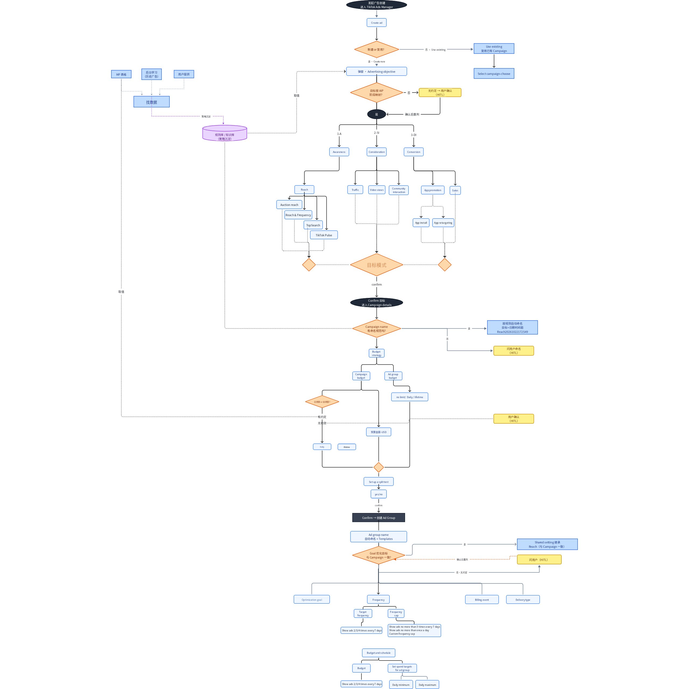
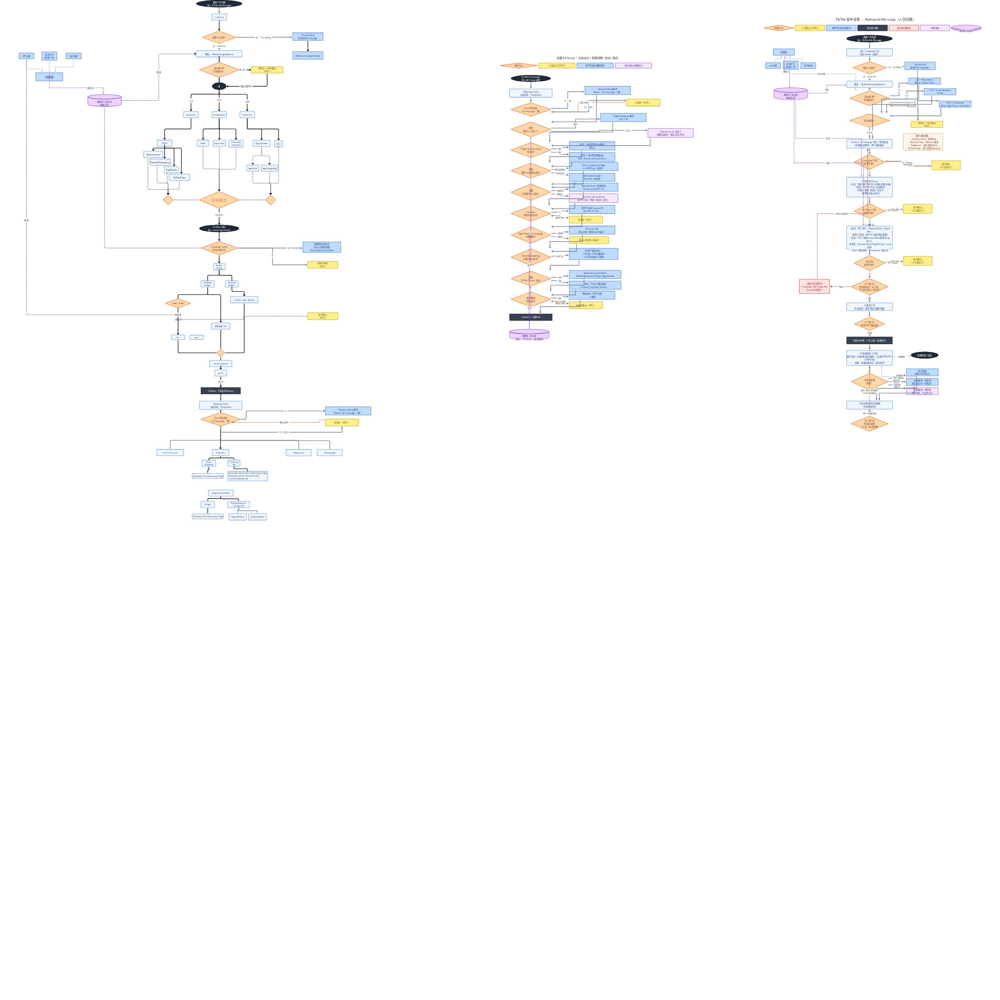
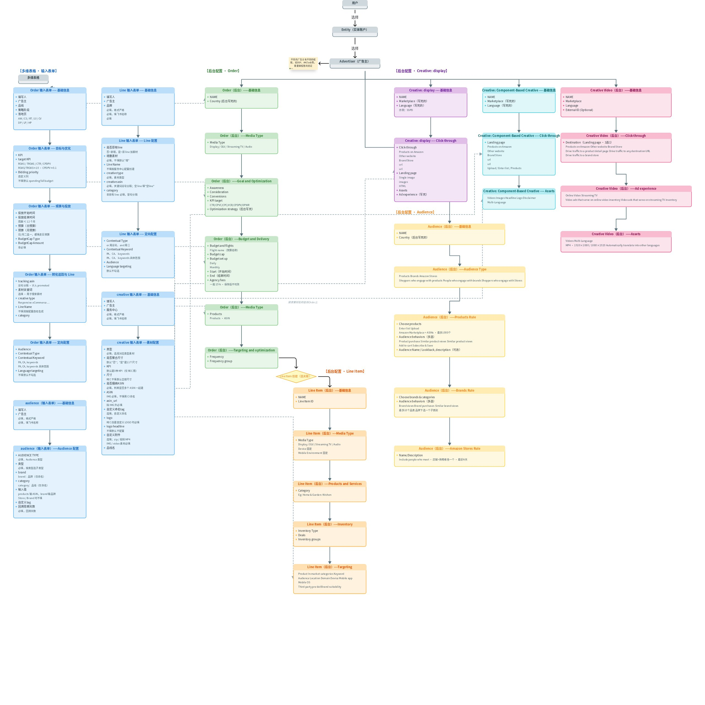

# 策略生成流程 & 平台投递逻辑

## 一、投前策略生成流程

| # | 阶段 | 步骤 | 角色 | 输入 | 动作/能力 | 依据/逻辑 | 数据来源 | 校验/标准 | 输出 | 备注 |
|---|---|---|---|---|---|---|---|---|---|---|
| 1 | 投前 | 需求接入 | 客户 -> 业务 | Brief | 任务解析/维度：目标分析、地区规划、预算分配、时间/周期、目标人群、文案内容、素材建议、版位建议、结果预估、产品信息；文档制作：表格/PPT/文档；数据收集：网页搜索、数据查询、数据分析 | 客户要求；同类型产品投放表现；数据洞察报告；目标地区节假日/促销节点；目标地区需求情况；关键词表现及热度；人群覆盖规模/吸引/转化；平台内容调性及用户习惯；过往客户投放数据；产品定位/信息/卖点 | 客户提供（邮件/附件/聊天软件/产品文档）；公网搜索（Google Search/Trend/关键词工具）；专业网站（similarweb/sensor tower/semrush）；广告平台（人群规模/关键词tag/素材倾向/用户习惯）；历史数据报告 | KPI达成、人群覆盖、预算控制、地区策略差异、投放目标丰富度、阶段过渡连贯性 | PPT方案、创编表格、策略文档 | 品牌侧人群和素材包容度比较高 |

## 二、平台投递逻辑

> 以下为 TikTok、Amazon DSP 的广告投放链路逻辑白板（由业务共创沉淀，展示平台从 Campaign/Order 到素材层的层级结构、决策判断与投递关系）。

### TikTok 投递逻辑（一）

TikTok 广告创建流程：发起创建 → 新建/复用 Campaign → 目标按 AIP 阶段映射（无约定则 HITL 人工确认）→ Awareness/Consideration/Conversion 三目标分支 → 命名/预算策略（有约定自动，无约定询问）→ 拆分测试 → Ad Group 创建（优化目标一致性校验）→ 频次/计费/投放类型 → 预算排期。全程以"MP 表格 + 历史广告 + 用户提供"数据支撑，沉淀至规则库/知识库形成策略闭环。

### TikTok 投递逻辑（二）

### Amazon DSP 投递逻辑

DSP 全流程：用户选择 Entity/Advertiser → 多维表格输入表单（Order/Line/Creative/Audience）→ 后台各模块配置（Order 的基础信息/Media/Goal/预算/定向，Creative 的 Display/组件化/Video，Audience 的 Products/Brands/Stores 规则，Line Item 的关联创建），前端录入与后台配置通过字段映射关联。

## 三、与 Skill 的衔接

- **策略生成流程**回答"怎么从 Brief 到策略"（投前）；
- **平台投递逻辑**回答"策略如何落到各平台的结构"（投中）；
- **问题知识库**（`ad-campaign-*-knowledge-base.md`）沉淀各平台创建过程中的踩坑与铁律（投中复盘）；
- **全链路拆解**（`ad-campaign-full-lifecycle.md`）覆盖投前/投中/投后完整业务视图。
